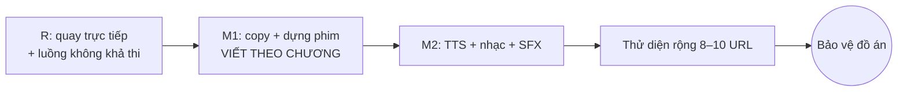

# HANDOFF — Short Video AI (URL → video marketing 9:16)

> Tài liệu bàn giao ngữ cảnh giữa các phiên làm việc. Cập nhật lần cuối: 2026-10-26.
> Dùng cho: (1) phiên chat lập kế hoạch mới với Claude; (2) agent Claude Code (đặt tại `docs/HANDOFF.md`).

## 0. Cách làm việc (giữ nguyên ở phiên mới)

- Trả lời **tiếng Việt**, cấu trúc rõ, hướng dẫn từng bước.
- Prompt cho agent phải **đầy đủ, copy dùng được ngay**.
- Thiết kế hệ thống: luôn có **Mermaid**, tách **High-level / Detailed**, luôn ghi **phạm vi MVP**.
- Quy trình với agent (Claude Code): agent trình bày kế hoạch → tôi duyệt/chỉnh → agent làm theo **commit nhỏ** → kiểm tra trước commit nối bằng `&&` + kiểm exit code → nghiệm thu bằng video/contact sheet/report → tôi gửi video cho Claude phân tích từng khung hình.
- Ưu tiên: **ra video tốt trên URL thật** trước; không sa lầy tinh chỉnh một site; mỗi vòng sửa có quy tắc dừng.

## 1. Sản phẩm

Người dùng nhập URL (+ tùy chọn đăng nhập) → hệ thống khám phá website → người dùng xác nhận hiểu sản phẩm, **chọn luồng chức năng chính** → storyboard → dàn ý → kịch bản (duyệt/sửa lặp lại bằng câu tự do) → hệ thống tự thao tác, quay màn hình, dựng video MP4 dọc 9:16 cho TikTok/Reels/Shorts.
Đồ án môn "Chuyên đề ngôn ngữ lập trình" — sản phẩm AI-core hoàn chỉnh.

## 2. Tech stack (đã chốt, đang chạy)

| Tầng | Công nghệ |
|---|---|
| Web | Next.js (App Router) + TS + Tailwind + shadcn/ui, polling 1.5s |
| API | FastAPI + Pydantic v2, **JobRunner file-based** (1 job chạy, còn lại xếp hàng), `FileFrontend` chặn thread chờ phản hồi |
| Pipeline | Python 3.12, uv; `run_job` dùng chung cho CLI (`TerminalFrontend`), web (`FileFrontend`), test (`ScriptedFrontend`) |
| Browser | Playwright (Python), lớp chung `app/browser` (locate, wait_for_settle, guard, blacklist, page_utils, login, session) |
| LLM | **DeepSeek** qua SDK openai; **LLM Router theo vai trò** (`LLM_<ROLE>_MODEL/VISION/PROVIDER`); `deepseek-chat` (text), `deepseek-flash` (vision); JSON mode + Pydantic + tự sửa 2 lần + cache |
| Render | Remotion (Node) — template mặc định **desktop_focus** (khung media 4:5, camera focus-first, karaoke, bullet, Be Vietnam Pro), hậu xử lý ffmpeg yuv420p + unsharp |
| Schema | `packages/script-schema/schemas/*.json` = nguồn sự thật → codegen Pydantic + Zod; `codegen-check` chống drift |
| Lưu trữ | File trong job-dir (`services/api/out/...`), chưa dùng Postgres/MinIO/Celery/LangGraph (để sau MVP) |
| Môi trường | Windows + PowerShell, pnpm workspace, không có `make` (dùng script pnpm/bash), lean-ctx đã cho phép bash |

## 3. Kiến trúc high-level

```mermaid
flowchart LR
    U[Web / CLI] --> RJ[run_job]
    RJ --> LG[Login gate<br/>cửa sổ / tài khoản demo / auth.json]
    LG --> EX[Explorer<br/>pages, features, demo_kind]
    EX --> CU[Xác nhận hiểu sản phẩm]
    CU --> FD[Flow Discovery<br/>3–5 luồng chính]
    FD --> SF[Người dùng chọn / mô tả luồng]
    SF --> FA[Flow Agent<br/>quan sát → 1 hành động → lặp<br/>+ quay trực tiếp]
    FA --> SB[Storyboard review]
    SB --> OL[Outline theo chương]
    OL --> SC[Script + Edit Planner<br/>duyệt/sửa lặp]
    SC --> PR[Producer<br/>cắt chương, dead-time, focus planner,<br/>quality gate]
    PR --> RD[Remotion render]
    RD --> V[(video.mp4 + report.json)]
```

Giao thức tương tác chung: `InteractionRequest(kind, …)` / `UserResponse(action, …)`; kind gồm login_required, confirm_understanding, select_features, select_flow, flow_storyboard_review, choose_concept, outline_review, script_review, video_review. Mọi sửa kịch bản quy về `EditOp` áp dụng tất định.

## 4. Quyết định thiết kế quan trọng (đừng làm ngược)

- **Core Flow > tính năng rời rạc**: video demo một luồng công việc trọn vẹn (persona + mục tiêu), không bấm lẻ tẻ.
- **Chính sách gửi dữ liệu**: mặc định *dừng trước khi gửi* (highlight nút Gửi làm cao trào); *cho phép gửi* chỉ khi người dùng xác nhận sandbox của họ; **cấm trên site demo dùng chung** (SHARED_DEMO_SITES, có OrangeHRM).
- **An toàn**: request guard chặn ghi (mở cửa sổ có kiểm soát chỉ ở pha đăng nhập / bước gửi được phép), blacklist theo ranh giới từ cho phần tử tương tác, bỏ trang phụ (login/register/checkout) và trang nhạy cảm (settings/billing/admin/invite), làm mờ email/SĐT/tên tài khoản khi có đăng nhập, credential mã hóa Fernet, phiên chỉ xóa khi job done/cancelled.
- **Camera focus-first** (đơn vị cover, min 1.0 / max 1.4, establishing ≤1s có nền mờ), **Focus Planner** (LLM chọn phần tử theo lời đọc) + quy tắc code: không cắt chữ, không zoom vào ảnh, bỏ qua nav/sidebar/footer.
- **Nhịp**: không tăng tốc cảnh thao tác (cắt đoạn chết thay vì speed-up), giữ 1.5s sau thao tác, tối đa 3 thao tác chính/scene.
- **Thời lượng trung thực**: đề xuất theo lượng nội dung có thật (content_budget).
- **Vi phạm hình thức (độ dài) tự cắt gọn**, không làm hỏng job; chỉ lỗi cấu trúc mới chặn.
- **Quality gate**: không bao giờ xuất video có cảnh trang đăng nhập.
- DeepSeek **đủ dùng** cho Flow Agent (benchmark: 6/6 trên luồng khả thi, 0 ref bịa); vision không tăng tỷ lệ đạt (+43% token) → mặc định text, **tự leo thang sang vision khi kẹt** (R2).

## 5. Trạng thái hiện tại

**Đã xong** (commit mới nhất trước lượt R: `485d3d0`): schema+codegen, explorer (demo_kind, locator nhiều tầng, upload, delta có trạng thái), proposal/outline, script writer + edit planner + scene writer, recorder, producer, render (desktop_focus), footage-first, web UI file-based, chọn tính năng, focus planner, đăng nhập 3 cách, Core Flow C0–C14 (router, discovery, select_flow, flow agent, storyboard, outline theo chương, quay một mạch + cắt chương, web cards, benchmark). pytest ~800 pass.

**Đang làm — lượt R "Flow chắc chắn"** (đã duyệt, agent đang chạy R0→R4):
- R0 đo độ lệch đồng hồ log/video bằng xung màu (xung không được lọt vào video cuối).
- R1 quay trực tiếp lúc agent chạy; cắt llm_wait / retry (nhận diện theo phần tử đã resolve) / rejected; replay chỉ dự phòng.
- R2 leo thang text → vision khi kẹt.
- R3 give_up có phân loại (no_data, no_permission, …) → thẻ "Không khả thi", chọn luồng khác.
- R4 nghiệm thu: OrangeHRM (xin nghỉ phép → không khả thi → "Thêm nhân viên mới", dừng trước Save, 0 request ghi), squoosh (footage ≥ 0.5, ≥ 4/5 bước), todomvc (allow).

## 6. Lộ trình tiếp theo

Kế hoạch chi tiết lượt P0 + M1: docs/plans/m1-flow.md

- **M1** (viết lại theo cấu trúc chương; `docs/plans/m1.md` đã lỗi thời): proof bank (cấm bịa số), khung kể PAS/BAB/Demo-Proof, hook ≤12 từ 5 kiểu + 2 phương án, lời đọc nói lợi ích theo persona, CTA có offer thật, Copy Critic (5 tiêu chí ≥7), stat callout, shot theo câu thoại (≤3s không đổi hình), hook "kết quả trước" (hero frame), trước/sau bằng màn hình thật, kinetic text, chặn khung hình chết, marketing scorecard.
- **M2**: TTS Edge TTS (vi-VN-HoaiMyNeural / NamMinhNeural, WordBoundary) mặc định, ElevenLabs tùy chọn, fallback ước tính; nhạc nền từ **Pixabay Music** (6 bài, 4 mood: upbeat/energetic/corporate/calm, file `services/api/assets/music/` + `LICENSES.md`), ducking −18dB, loudnorm −14 LUFS; SFX sinh bằng code; xuất thêm bản không nhạc.
- **Thử diện rộng**: `--auto-default`, batch 8–10 URL (excalidraw, tldraw, regex101, carbon.now.sh, coolors, squoosh, 2 SaaS EN, 2 site VN), bảng lớp lỗi → sửa 2–3 lớp lớn nhất.

## 7. Vấn đề đã biết / tồn đọng

- Replay trên control tự vẽ (squoosh) mong manh → đang xử lý bằng quay trực tiếp (R1).
- Nội dung marketing còn đơn giản, video **chưa có âm thanh** → M1, M2.
- Hook/camera đôi lúc zoom quá sát (M1).
- Luồng phụ (luồng thứ 2) chưa được dựng.
- Cách A (cửa sổ đăng nhập) chỉ chạy khi API cùng máy người dùng; deploy server cần noVNC (sau MVP).
- Chữ khi zoom hơi mềm (nguồn 1440×900, Playwright không quay được 2x).

## 8. URL demo đã kiểm chứng

| Loại | URL | Ghi chú |
|---|---|---|
| Công cụ public | https://squoosh.app | luồng nén + so sánh |
| Web app public | https://todomvc.com/examples/react/dist/ | luồng lên danh sách việc (allow, localStorage) |
| Cần đăng nhập | https://opensource-demo.orangehrmlive.com | Admin / admin123, site dùng chung → chỉ "dừng trước khi gửi" |
| Landing page | https://plausible.io, aisoeasy.co | tour giá trị |

## 9. File/thư mục quan trọng

- `CLAUDE.md` — quy tắc dự án cho agent (ngôn ngữ tiếng Việt, phụ thuộc module, an toàn, quy ước commit).
- `docs/` — benchmark (`explore-benchmark.md`, `core-flow/llm-benchmark.md`), nghiệm thu (`visual-v2/`, `login-acceptance/`, `core-flow/`), `demo-notes.md`, `manual-test-login.md`, `screenshots/`, `TODO.md`.
- `services/api/app/` — `browser/`, `explorer/`, `proposal/`, `flows/`, `script/`, `recorder/`, `producer/`, `llm/` (router, prompts/*.md), `core/`, `api/`, `pipeline/`.
- `apps/render/src/` — `templates/DesktopFocus`, `camera/`, `icons/`. `apps/web/` — trang chủ, `/jobs/[id]`, thẻ tương tác.
- Chạy demo: `docker compose -f infra/docker-compose.yml down` (giải phóng cổng) → `pnpm dev:all` → http://localhost:3000.

## 10. Bắt đầu phiên mới

- **Phiên chat với Claude**: dán toàn bộ file này + báo cáo mới nhất của agent, câu mở: *"Đây là handoff dự án, tiếp tục từ mục 5–6. Báo cáo mới nhất của agent: …"*.
- **Agent Claude Code**: lưu file này tại `docs/HANDOFF.md`; trong Claude Code dùng `/clear` rồi gửi: *"Đọc CLAUDE.md và docs/HANDOFF.md. Tiếp tục lượt đang làm ở mục 5."* Agent tự cập nhật mục 5–7 của file này sau mỗi lượt lớn.
