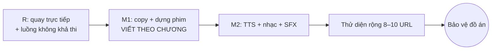

# HANDOFF — Short Video AI (URL → video marketing 9:16)

> Tài liệu bàn giao ngữ cảnh giữa các phiên làm việc. Cập nhật lần cuối: 2026-10-26.
> Dùng cho: (1) phiên chat lập kế hoạch mới với Claude; (2) agent Claude Code (đặt tại `docs/HANDOFF.md`).

## 0. Cách làm việc (giữ nguyên ở phiên mới)

- Trả lời **tiếng Việt**, cấu trúc rõ, hướng dẫn từng bước.
- Prompt cho agent phải **đầy đủ, copy dùng được ngay**.
- Thiết kế hệ thống: luôn có **Mermaid**, tách **High-level / Detailed**, luôn ghi **phạm vi MVP**.
- Quy trình với agent (Claude Code): agent trình bày kế hoạch → tôi duyệt/chỉnh → agent làm theo **commit nhỏ** → kiểm tra trước commit nối bằng `&&` + kiểm exit code → nghiệm thu bằng video/contact sheet/report → tôi gửi video cho Claude phân tích từng khung hình.
- Ưu tiên: **ra video tốt trên URL thật** trước; không sa lầy tinh chỉnh một site; mỗi vòng sửa có quy tắc dừng.

## 1. Sản phẩm

Người dùng nhập URL (+ tùy chọn đăng nhập) → hệ thống khám phá website → người dùng xác nhận hiểu sản phẩm, **chọn luồng chức năng chính** → storyboard → dàn ý → kịch bản (duyệt/sửa lặp lại bằng câu tự do) → hệ thống tự thao tác, quay màn hình, dựng video MP4 dọc 9:16 cho TikTok/Reels/Shorts.
Đồ án môn "Chuyên đề ngôn ngữ lập trình" — sản phẩm AI-core hoàn chỉnh.

## 2. Tech stack (đã chốt, đang chạy)

| Tầng | Công nghệ |
|---|---|
| Web | Next.js (App Router) + TS + Tailwind + shadcn/ui, polling 1.5s |
| API | FastAPI + Pydantic v2, **JobRunner file-based** (1 job chạy, còn lại xếp hàng), `FileFrontend` chặn thread chờ phản hồi |
| Pipeline | Python 3.12, uv; `run_job` dùng chung cho CLI (`TerminalFrontend`), web (`FileFrontend`), test (`ScriptedFrontend`) |
| Browser | Playwright (Python), lớp chung `app/browser` (locate, wait_for_settle, guard, blacklist, page_utils, login, session) |
| LLM | **DeepSeek** qua SDK openai; **LLM Router theo vai trò** (`LLM_<ROLE>_MODEL/VISION/PROVIDER`); `deepseek-chat` (text), `deepseek-flash` (vision); JSON mode + Pydantic + tự sửa 2 lần + cache |
| Render | Remotion (Node) — template mặc định **desktop_focus** (khung media 4:5, camera focus-first, karaoke, bullet, Be Vietnam Pro), hậu xử lý ffmpeg yuv420p + unsharp |
| Schema | `packages/script-schema/schemas/*.json` = nguồn sự thật → codegen Pydantic + Zod; `codegen-check` chống drift |
| Lưu trữ | File trong job-dir (`services/api/out/...`), chưa dùng Postgres/MinIO/Celery/LangGraph (để sau MVP) |
| Môi trường | Windows + PowerShell, pnpm workspace, không có `make` (dùng script pnpm/bash), lean-ctx đã cho phép bash |

## 3. Kiến trúc high-level

```mermaid
flowchart LR
    U[Web / CLI] --> RJ[run_job]
    RJ --> LG[Login gate<br/>cửa sổ / tài khoản demo / auth.json]
    LG --> EX[Explorer<br/>pages, features, demo_kind]
    EX --> CU[Xác nhận hiểu sản phẩm]
    CU --> FD[Flow Discovery<br/>3–5 luồng chính]
    FD --> SF[Người dùng chọn / mô tả luồng]
    SF --> FA[Flow Agent<br/>quan sát → 1 hành động → lặp<br/>+ quay trực tiếp]
    FA --> SB[Storyboard review]
    SB --> OL[Outline theo chương]
    OL --> SC[Script + Edit Planner<br/>duyệt/sửa lặp]
    SC --> PR[Producer<br/>cắt chương, dead-time, focus planner,<br/>quality gate]
    PR --> RD[Remotion render]
    RD --> V[(video.mp4 + report.json)]
```

Giao thức tương tác chung: `InteractionRequest(kind, …)` / `UserResponse(action, …)`; kind gồm login_required, confirm_understanding, select_features, select_flow, flow_storyboard_review, choose_concept, outline_review, script_review, video_review. Mọi sửa kịch bản quy về `EditOp` áp dụng tất định.

## 4. Quyết định thiết kế quan trọng (đừng làm ngược)

- **Core Flow > tính năng rời rạc**: video demo một luồng công việc trọn vẹn (persona + mục tiêu), không bấm lẻ tẻ.
- **Chính sách gửi dữ liệu**: mặc định *dừng trước khi gửi* (highlight nút Gửi làm cao trào); *cho phép gửi* chỉ khi người dùng xác nhận sandbox của họ; **cấm trên site demo dùng chung** (SHARED_DEMO_SITES, có OrangeHRM).
- **An toàn**: request guard chặn ghi (mở cửa sổ có kiểm soát chỉ ở pha đăng nhập / bước gửi được phép), blacklist theo ranh giới từ cho phần tử tương tác, bỏ trang phụ (login/register/checkout) và trang nhạy cảm (settings/billing/admin/invite), làm mờ email/SĐT/tên tài khoản khi có đăng nhập, credential mã hóa Fernet, phiên chỉ xóa khi job done/cancelled.
- **Camera focus-first** (đơn vị cover, min 1.0 / max 1.4, establishing ≤1s có nền mờ), **Focus Planner** (LLM chọn phần tử theo lời đọc) + quy tắc code: không cắt chữ, không zoom vào ảnh, bỏ qua nav/sidebar/footer.
- **Nhịp**: không tăng tốc cảnh thao tác (cắt đoạn chết thay vì speed-up), giữ 1.5s sau thao tác, tối đa 3 thao tác chính/scene.
- **Thời lượng trung thực**: đề xuất theo lượng nội dung có thật (content_budget).
- **Vi phạm hình thức (độ dài) tự cắt gọn**, không làm hỏng job; chỉ lỗi cấu trúc mới chặn.
- **Quality gate**: không bao giờ xuất video có cảnh trang đăng nhập.
- DeepSeek **đủ dùng** cho Flow Agent (benchmark: 6/6 trên luồng khả thi, 0 ref bịa); vision không tăng tỷ lệ đạt (+43% token) → mặc định text, **tự leo thang sang vision khi kẹt** (R2).

## 5. Trạng thái hiện tại

**Đã xong** (commit mới nhất trước lượt R: `485d3d0`): schema+codegen, explorer (demo_kind, locator nhiều tầng, upload, delta có trạng thái), proposal/outline, script writer + edit planner + scene writer, recorder, producer, render (desktop_focus), footage-first, web UI file-based, chọn tính năng, focus planner, đăng nhập 3 cách, Core Flow C0–C14 (router, discovery, select_flow, flow agent, storyboard, outline theo chương, quay một mạch + cắt chương, web cards, benchmark). pytest ~800 pass.

**Lượt R "Flow chắc chắn": đã xong** (quay trực tiếp, cắt llm_wait/retry/rejected, vision tự leo thang, luồng không khả thi, nghiệm thu R4 — commit `2729ab1`).

**Lượt P0 + M1** (kế hoạch: `docs/plans/m1-flow.md`):
- P0-a xong: pytest -n auto ổn định (838 pass, 3 lần liên tiếp). Nguyên nhân gốc: test chờ theo đồng hồ (300ms/7s/20s) trong khi máy tải nặng với 12 worker; đã đổi sang chờ theo điều kiện/đếm; thêm pytest-timeout (120s, test trình duyệt/ffmpeg 300s) và pytest-repeat.
- P0-b xong: give_up `no_data`/`feature_missing` chỉ được chấp nhận khi có thông báo thật của trang hoặc đã thử mở menu khớp mô tả (code `give_up_has_evidence`, từ chối tối đa 2 lần rồi hạ thành `stuck`; prompt flow_agent.md rule 9). `normalize_flow` chọn start_url là trang đã khám phá gần mô tả nhất. Dữ liệu `out/r4-orangehrm` chỉ cho thấy luồng nghỉ phép bị đánh không khả thi (cùng start_url với luồng Discovery; chỉ khác là luồng người dùng cần điền form); hai luồng «Thêm nhân viên mới/Thêm ứng viên» không bị đánh dấu trong dữ liệu đã lưu — sửa dựa trên nguyên nhân giả định ở trên, test hồi quy dùng `tests/fixtures/orangehrm_flows.json`.
- P0-c xong: `flow_report.steps_in_clip` (+ `scripts/steps_in_clip.py`); 3 video R4 đều 100% (`docs/core-flow/r4/steps_in_clip.json`).
- M1-1 xong: `app/script/proof.py` (proof bank: numbers/quotes/offers/pains; `unsupported_numbers`, `strip_numbers`).
- M1-2 xong: schema `script.framework`, `script.hook_options` (2 phương án), `scene.stat`, EditOp `set` field `hook_option` (chọn hook không gọi LLM); `core/hero.py` (hero frame chấm bằng code); `FlowCtx` thêm value_line/submit_policy/hero_texts; writer kiểm bằng code (`script/narrative.py`): hook 5–12 từ, không mở bằng tên sản phẩm, 2 hook khác kiểu, cụm sáo rỗng, on_screen ≤ 5 từ, CTA không đọc URL, con số có nguồn (hỏi lại 1 lần rồi code xóa → duration_fit). `hook_options` bắt buộc chỉ ở chế độ luồng; ngoài luồng là tùy chọn. Hook scene luôn lấy phương án 1; M1-3 sẽ chọn theo điểm critic.
- M1-3 xong: `app/script/critic.py` + `prompts/copy_critic.md` (nguyên văn): chọn hook theo điểm hook_strength của từng phương án, chấm 5 tiêu chí, dưới 7 → Scene Writer viết lại cảnh yếu (tối đa 3, 1 vòng) → chấm lại, giữ bản tốt hơn; điểm trước/sau trong `script_report.json["critic"]`; chỉ chạy ở chế độ luồng, lỗi critic không làm hỏng job; sau khi người dùng sửa chỉ hiển thị điểm cũ (`edited`). Web script_review: 5 thanh điểm + chọn 1 trong 2 hook (EditOp `hook_option`, không gọi LLM).
- M1-4 xong (2 commit): **4a** hook cắt 1,5–2,5 s quanh hero frame chấm bằng code (`core/hero.py`, `FlowRecorder._hook`; dự phòng theo bước hero cũ), khung hook luôn tight/medium (`enforce_hook_framing`), mỗi cụm lời đọc là một shot + punch-in +8–12% trong 6 frame, không đoạn nào >3,0 s không đổi (`producer/shots.py`), cắt khung chết >300 ms trước khi cắt dead-time (`producer/dead_frames.py`, `dead_frames_ms` đo trên clip cảnh vì video cuối có nền/tiêu đề nên không phẳng), tight giữ thêm nhãn/heading gần nhất (`with_context`, đếm `context_limited`), thống kê thẻ chữ (`text_cards`). **4b** template: chữ động theo từ khớp lời đọc, stat callout né tiêu điểm, before/after = layout mới `split_frames` của scene before_after (2 ảnh thật: khung đầu + hero, chỉ xuất hiện khi `FlowCtx.before_after_pair`, voiceover 4–7 từ), CTA nền là hero frame + zoom nhẹ vào item nổi bật + tên miền ngắn dưới nút (`apps/render/.../finish.ts` + test thuần).
  - Giới hạn đã biết: thẻ chữ toàn màn hình chỉ được báo cáo/cảnh báo (`text_cards.ok`), chưa tự thay bằng ảnh; clip Playwright không có âm thanh/2x nên chữ khi zoom vẫn hơi mềm; chưa render thử video thật cho các quy tắc 4b (làm ở M1-6).
- M1-5 xong: `producer/scorecard.py` (10 dòng đạt/không đạt + âm thanh «chưa có (M2)» không tính) ghi `report.json["scorecard"]`, hiện ở trang video trên web.
- M1-6 xong (nghiệm thu, thư mục `docs/m1/`: `<tên>.md`, contact sheet 16 khung, still hook; video ở `services/api/out/m1-{orangehrm,squoosh,todomvc}/video.mp4`):
  | Video | Scorecard | Critic (hook / lợi ích / kêu gọi) |
  |---|---|---|
  | orangehrm «Thêm nhân viên mới» (stop, 0 request ghi) | 7/10 | 5 / 6 / 6 → **chưa đạt** |
  | squoosh nén + so sánh | 9/10 | 8 / 6 / 7 → lợi ích chưa đạt |
  | todomvc «lên danh sách việc» | 8/10 | 7 / 6 / 6 → lợi ích, CTA chưa đạt |
  Các tiêu chí dựng phim (khung hook gần, shot ≤ 3 s, 0 khung chết, thẻ chữ, footage ≥ 60%, steps_in_clip 100%) đều đạt ở cả 3 video; chỗ chưa đạt là **chất lượng lời** (DeepSeek chưa viết lợi ích/CTA đủ sắc, vòng viết lại 1 lần chỉ giúp được một phần).
  - Lỗi tìm ra khi nghiệm thu và đã sửa: hook_options dài quá 12 từ làm hỏng cả job (nay code cắt, ghi `auto_trimmed`); camera luôn mở bằng cảnh toàn trang nên «hook gần» chỉ đúng trên giấy (nay `closeOpening` cho hook, có test).
  - Kiểm tra cuối: pytest -n auto 3 lần liên tiếp 894 pass, ruff, codegen-check, tsc + vitest (render 120, web 43) đều pass. Trong lúc đó lộ thêm 3 test chờ theo đồng hồ (hàng đợi API, recorder 1440x900, login secrets) và đã đổi sang chờ theo điều kiện/dung sai rộng.

**Lượt CAM «Camera & nhịp»** (kế hoạch `docs/plans/cam.md`; thứ tự D → A → B → C → nghiệm thu → E):
- D xong: `app/producer/motion_qa.py` đo từ pixel video cuối (zoom/pan mỗi khung, đứng yên rồi giật, cảnh chớp, đứng yên tuyệt đối, ảnh đang tải, chữ tiêu điểm bị cắt, tiêu điểm khớp lời/thao tác) → `report.json["motion_qa"]` + 8 dòng scorecard; `scripts/motion_qa.py`, `scripts/camera_preview.py` (xem lộ trình camera không render), `scripts/cam_table.py`; số liệu «trước» của 3 video M1 ở `docs/cam/README.md` (đúng chẩn đoán: zoom 11–17%/khung, đứng yên 1,3–2 s, tiêu điểm khớp 28–74%). Camera đi qua một cửa duy nhất `cameraForScene` (apps/render/src/camera/scene.ts).
- A xong: `apps/render/src/camera/path.ts` lập lộ trình MỘT lần cho cả clip thay cho spring từng khung: mỗi tiêu điểm là một chuyển động 400–900 ms (dài hơn khi zoom/pan lớn) bắt đầu 400 ms TRƯỚC mốc, ease smoothstep, kẹp cứng zoom ≤ 2,5%/khung và pan ≤ 1,5%/khung (không kịp thì đi sớm hơn, rồi mới đứng xa hơn/đi một phần), giữ hình luôn trôi 1%/giây, gộp 2 tiêu điểm gần nhau < 1,2 s, scene cùng trang tiếp tục từ chỗ camera scene trước dừng (`same_page` do `FlowRecorder.continues`), hook mở sẵn gần; punch-in ≤ 6% (9 khung) và nhường chỗ cho chuyển động (`quietWeight`). Hằng số ở `camera/config.ts`; test thuần ở `path.test.ts`. Trên todomvc: zoom tối đa 11,5% → 2,3%/khung, đứng yên rồi giật 1 → 0.
- B xong: tiêu điểm = phần tử + nhãn (ô nhập + label, nút + 12% quanh), không mở ra cả form/card; ảnh/canvas ≥ 15% khung không bao giờ là tiêu điểm (thay bằng nhãn có đơn vị hoặc bảng điều khiển); phần tử được lời đọc nhắc thắng kế hoạch của LLM trừ phần tử đang thao tác; khi gõ giữ ô vừa điền; nút gửi chỉ ở chương cuối sau khi form đã điền; hook trên form đã điền dùng `filled` của inventory. Nguyên nhân gốc N4 tìm ra: id phần tử trùng giữa các trang (`e75` là «Add» ở danh sách, «Cancel» ở form) → mỗi lần tải trang có salt riêng (`inventory.py`), dữ liệu cũ được kiểm bằng `target_text` (`trusted_actions`, `contradicted`); test với dữ liệu thật đã lưu ở `tests/fixtures/cam` + `test_cam_regression.py`.
- C xong: khung chết mở rộng (ảnh/canvas lớn còn là một mảng xám/đen phẳng ≥ 50% ô lưới, dù có thanh công cụ đè lên; chỉ cắt khi nó kết thúc trong clip và ≤ 4 s), mọi đoạn giữa hai điểm cắt ≥ 0,8 s (`enforce_min_shot`), chỗ nối đổi hình nhiều thì hòa tan 160 ms (ffmpeg `xfade`, `Cut.fade_ms`), không đặt điểm cắt trong ±300 ms quanh lúc có phần tử mới (`new_item_windows`).
- Tiếp theo: nghiệm thu (3 luồng cũ + 3 site mới, `docs/cam/README.md`, `docs/cam/generalization.md`) → E (lời).
- Tiếp theo sau CAM: M2 (TTS + nhạc + SFX).

## 6. Lộ trình tiếp theo

Kế hoạch chi tiết lượt P0 + M1: docs/plans/m1-flow.md
Kế hoạch lượt CAM: docs/plans/cam.md

- **M1** (đang làm; viết theo cấu trúc chương, kế hoạch `docs/plans/m1-flow.md`, `m1.md` đã lỗi thời): proof bank (cấm bịa số), khung kể PAS/BAB/Demo-Proof, hook ≤12 từ 5 kiểu + 2 phương án, lời đọc nói lợi ích theo persona, CTA có offer thật, Copy Critic (5 tiêu chí ≥7), stat callout, shot theo câu thoại (≤3s không đổi hình), hook "kết quả trước" (hero frame), trước/sau bằng màn hình thật, kinetic text, chặn khung hình chết, marketing scorecard.
- **M2**: TTS Edge TTS (vi-VN-HoaiMyNeural / NamMinhNeural, WordBoundary) mặc định, ElevenLabs tùy chọn, fallback ước tính; nhạc nền từ **Pixabay Music** (6 bài, 4 mood: upbeat/energetic/corporate/calm, file `services/api/assets/music/` + `LICENSES.md`), ducking −18dB, loudnorm −14 LUFS; SFX sinh bằng code; xuất thêm bản không nhạc.
- **Thử diện rộng**: `--auto-default`, batch 8–10 URL (excalidraw, tldraw, regex101, carbon.now.sh, coolors, squoosh, 2 SaaS EN, 2 site VN), bảng lớp lỗi → sửa 2–3 lớp lớn nhất.

## 7. Vấn đề đã biết / tồn đọng

- Replay trên control tự vẽ (squoosh) mong manh → đã xử lý bằng quay trực tiếp (R1); replay chỉ còn là dự phòng.
- Nội dung marketing còn đơn giản, video **chưa có âm thanh** → M1, M2.
- Hook/camera zoom quá sát: đã có giới hạn giữ nhãn gần nhất (M1-4a), cần xem lại trên video thật.
- Chất lượng lời (M1): hook bị code cắt cho đủ ≤ 12 từ có thể cụt ý (ví dụ «…chỉ với một cú.»); stat đôi khi lấy số của dữ liệu mẫu trên màn hình (OrangeHRM «0736» là mã nhân viên) — đúng nguồn nhưng không phải lợi ích; critic dưới 7 ở ít nhất một tiêu chí trên cả 3 URL.
- Thẻ chữ toàn màn hình chỉ được báo cáo, chưa tự thay bằng ảnh; `hook_options` chỉ bắt buộc ở chế độ luồng.
- Critic dùng chung model với writer (`copy_critic` trong router chưa được nối vào ScriptRunner khi chạy thật).
- Luồng phụ (luồng thứ 2) chưa được dựng.
- Cách A (cửa sổ đăng nhập) chỉ chạy khi API cùng máy người dùng; deploy server cần noVNC (sau MVP).
- Chữ khi zoom hơi mềm (nguồn 1440×900, Playwright không quay được 2x).

## 8. URL demo đã kiểm chứng

| Loại | URL | Ghi chú |
|---|---|---|
| Công cụ public | https://squoosh.app | luồng nén + so sánh |
| Web app public | https://todomvc.com/examples/react/dist/ | luồng lên danh sách việc (allow, localStorage) |
| Cần đăng nhập | https://opensource-demo.orangehrmlive.com | Admin / admin123, site dùng chung → chỉ "dừng trước khi gửi" |
| Landing page | https://plausible.io, aisoeasy.co | tour giá trị |

## 9. File/thư mục quan trọng

- `CLAUDE.md` — quy tắc dự án cho agent (ngôn ngữ tiếng Việt, phụ thuộc module, an toàn, quy ước commit).
- `docs/` — benchmark (`explore-benchmark.md`, `core-flow/llm-benchmark.md`), nghiệm thu (`visual-v2/`, `login-acceptance/`, `core-flow/`), `demo-notes.md`, `manual-test-login.md`, `screenshots/`, `TODO.md`.
- `services/api/app/` — `browser/`, `explorer/`, `proposal/`, `flows/`, `script/`, `recorder/`, `producer/`, `llm/` (router, prompts/*.md), `core/`, `api/`, `pipeline/`.
- `apps/render/src/` — `templates/DesktopFocus`, `camera/`, `icons/`. `apps/web/` — trang chủ, `/jobs/[id]`, thẻ tương tác.
- Chạy demo: `docker compose -f infra/docker-compose.yml down` (giải phóng cổng) → `pnpm dev:all` → http://localhost:3000.

## 10. Bắt đầu phiên mới

- **Phiên chat với Claude**: dán toàn bộ file này + báo cáo mới nhất của agent, câu mở: *"Đây là handoff dự án, tiếp tục từ mục 5–6. Báo cáo mới nhất của agent: …"*.
- **Agent Claude Code**: lưu file này tại `docs/HANDOFF.md`; trong Claude Code dùng `/clear` rồi gửi: *"Đọc CLAUDE.md và docs/HANDOFF.md. Tiếp tục lượt đang làm ở mục 5."* Agent tự cập nhật mục 5–7 của file này sau mỗi lượt lớn.
