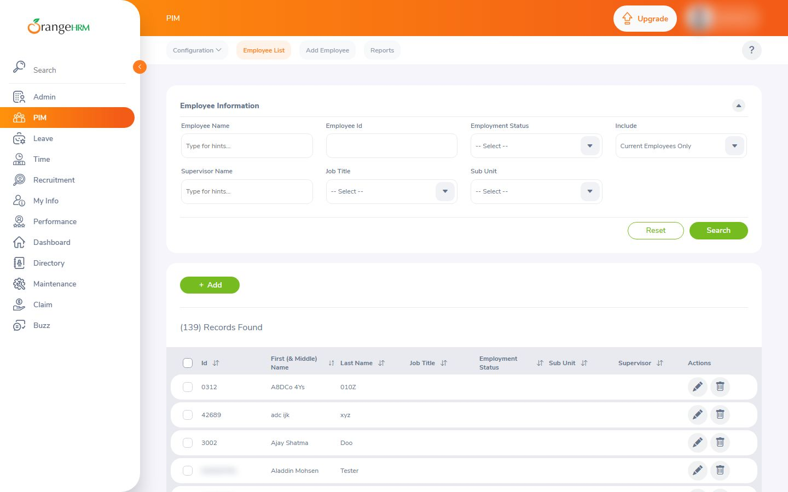
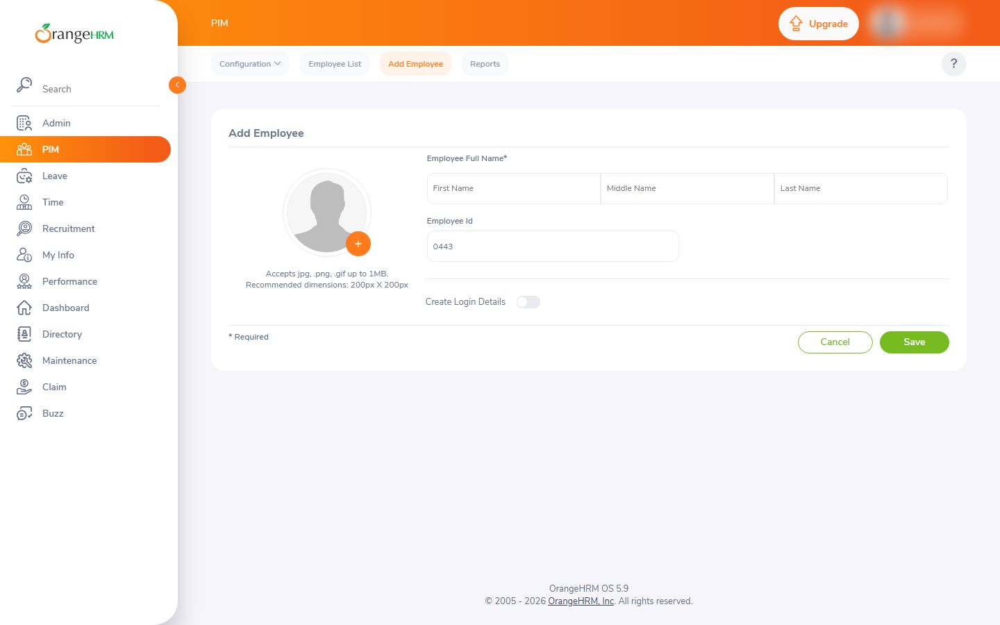
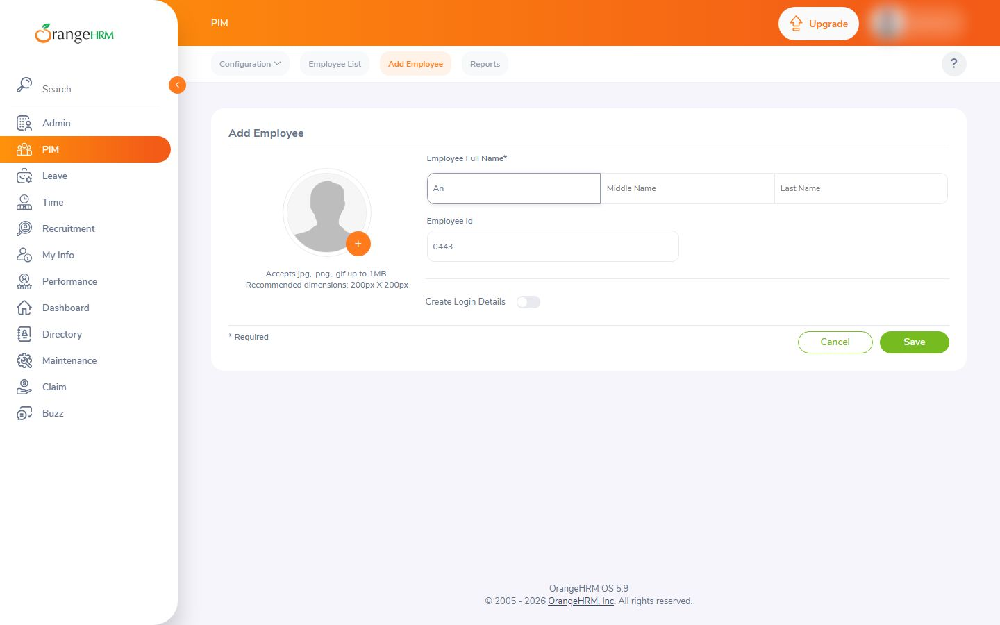
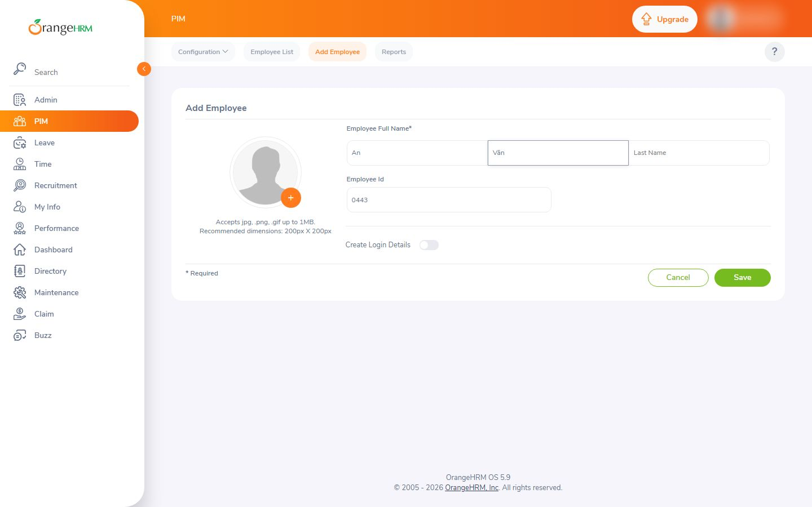
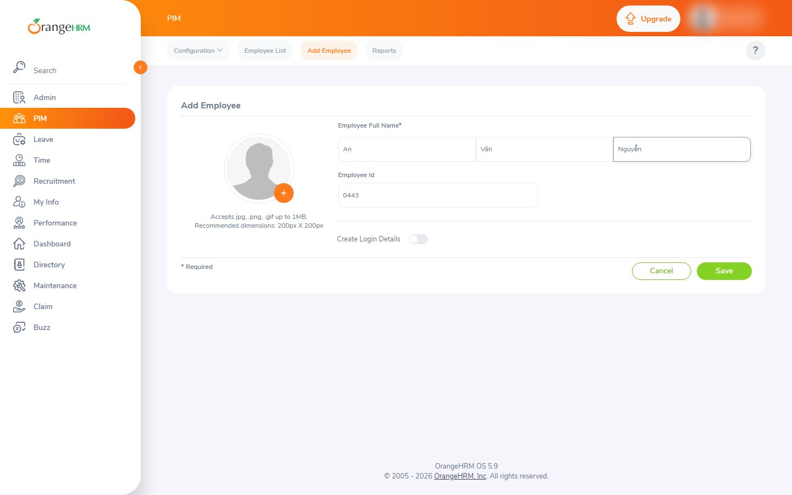

# Nghiệm thu luồng: orangehrm_add

- Trạng thái luồng: **stopped_before_submit** · chính sách gửi: `stop` · dừng ở nút «Save»
- Agent: 5 lần gọi LLM, 53.9 s, model `deepseek-chat`, chỉ đọc chữ, 11955 token; ref bịa bị từ chối: 0; cảnh báo lặp: 0
- Phát lại khi quay: None/6 bước
- **Request ghi dữ liệu: 0** (agent 0, quay 0) ✔
- Video: None ms, tỉ lệ cảnh quay None
- Nguồn clip: `None` · cắt chờ LLM None ms · cắt None đoạn thử lại, None đoạn bị từ chối
- Gọi agent: 5 chữ, 0 ảnh (lý do thêm ảnh: None)
- Xung đồng bộ lọt vào video cuối: **None** (phải là False) · still khung đầu: `orangehrm_add-first-frame.png`

## Bảng chương

| Chương | Bước | Thời lượng | Quay | Lời đọc |
|---|---|---|---|---|
| Mở form | 1–2 | 0.0 s | — | Mở trang PIM rồi bấm Add — hồ sơ nhân viên mới bắt đầu ngay trong một bảng điều khiển. |
| Điền thông tin | 3–5 | 0.0 s | — | Gõ họ tên và tên đệm Văn trên form, thông tin vào thẳng hồ sơ tập trung. |
| Kiểm tra và dừng trước khi lưu | 6–7 | 0.0 s | — | Họ tên và mã nhân viên đã đầy đủ, chỉ còn một bước Save. |

## Storyboard

### Mở form

1. Mở trang bắt đầu  
   
2. Bấm nút Add để mở luồng tạo hồ sơ nhân viên mới  
   

### Điền thông tin

3. Nhập tên (First Name) của nhân viên mới.  
   
4. Nhập tên đệm Văn vào ô Middle Name.  
   
5. Nhập họ của nhân viên vào ô Last Name.  
   

### Kiểm tra và dừng trước khi lưu

6. Form đã điền đầy đủ họ tên và mã nhân viên, dừng lại trước nút Save để chưa tạo hồ sơ  
   
7. Form đã điền đầy đủ họ tên và mã nhân viên, dừng lại trước nút Save để chưa tạo hồ sơ  
   

## Lần gọi LLM của cả job

| Bước | Lần gọi | Token vào | Token ra |
|---|---|---|---|
| script | 3 | 20359 | 3451 |
| scene | 4 | 11352 | 967 |
| flow_agent | 5 | 11548 | 407 |
| copy_critic | 3 | 6534 | 3275 |
| fit | 5 | 7091 | 1305 |
| synthesize | 1 | 2923 | 4817 |
| flow_discovery | 2 | 4111 | 3282 |
| analyze | 2 | 2243 | 427 |
| classify | 1 | 372 | 114 |

## Số liệu

```json
{
  "status": "stopped_before_submit",
  "steps": 7,
  "chapters": 3,
  "agent_llm_calls": 5,
  "agent_seconds": 53.9,
  "agent_model": "deepseek-chat",
  "agent_used_images": false,
  "agent_tokens": 11955,
  "invented_refs": 0,
  "repeat_warnings": 0,
  "replayed": null,
  "replay_failed_at": null,
  "skipped_steps": [],
  "write_requests": 0,
  "video_ms": null,
  "footage_ratio": null,
  "shared_demo_site": true,
  "clip_source": null,
  "llm_wait_cut_ms": null,
  "retry_segments_cut": null,
  "rejected_segments_cut": null,
  "text_calls": 5,
  "vision_calls": 0,
  "escalated_because": null,
  "pulse_in_final_video": null,
  "first_frame_still": false,
  "writes_ok": true
}
```
