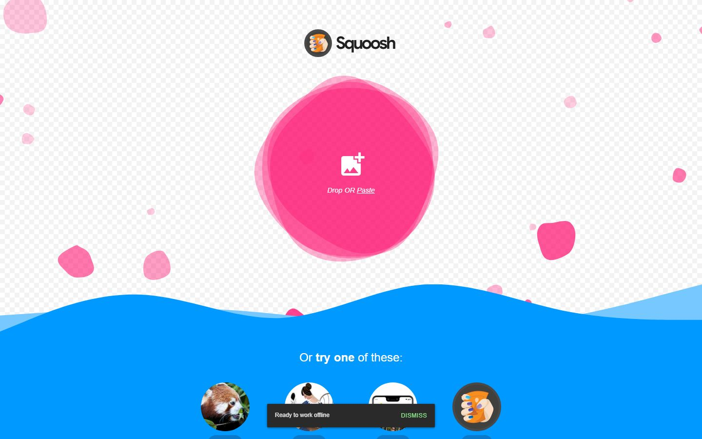
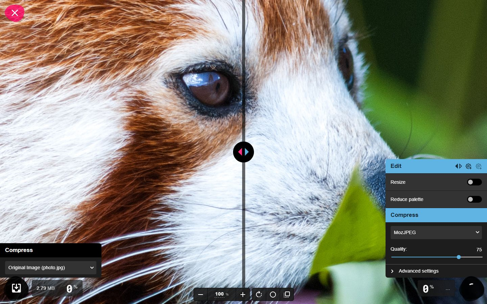
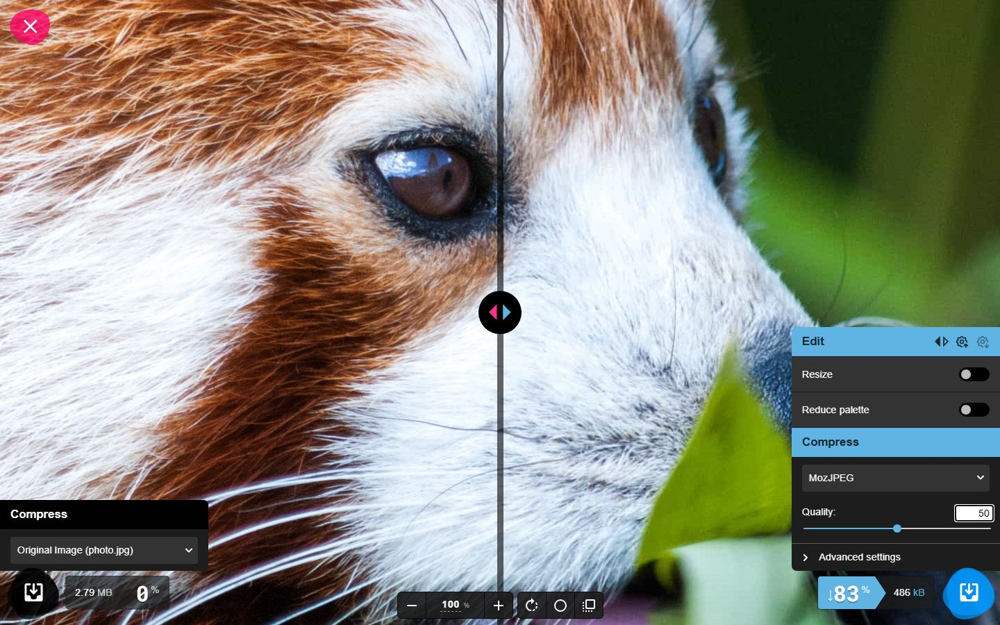

# Nghiệm thu luồng: squoosh

- Trạng thái luồng: **reached_goal** · chính sách gửi: `stop`
- Agent: 5 lần gọi LLM, 40.0 s, model `deepseek-flash`, có nhìn ảnh, 17157 token; ref bịa bị từ chối: 0; cảnh báo lặp: 1
- Phát lại khi quay: None/2 bước
- **Request ghi dữ liệu: 0** (agent 0, quay 0) ✔
- Video: None ms, tỉ lệ cảnh quay None
- Nguồn clip: `None` · cắt chờ LLM None ms · cắt None đoạn thử lại, None đoạn bị từ chối
- Gọi agent: 0 chữ, 5 ảnh (lý do thêm ảnh: trang có canvas/svg lớn)
- Xung đồng bộ lọt vào video cuối: **None** (phải là False) · still khung đầu: `squoosh-first-frame.png`

## Bảng chương

| Chương | Bước | Thời lượng | Quay | Lời đọc |
|---|---|---|---|---|
| Chọn ảnh mẫu | 1–2 | 0.0 s | — | Mở trình duyệt là có ngay ảnh mẫu để thử, không cần cài đặt gì cả. |
| Điều chỉnh nén | 3–3 | 0.0 s | — | Hạ chất lượng xuống 50, dung lượng tệp giảm hẳn so với ảnh gốc 2.79MB, và ảnh đã nén được lưu về máy. |

## Storyboard

### Chọn ảnh mẫu

1. Mở trang bắt đầu  
   
2. Mình bấm chọn ảnh mẫu 2.8MB để đưa vào công cụ nén.  
   

### Điều chỉnh nén

3. Hạ chất lượng nén xuống 50 để xem dung lượng tệp giảm bao nhiêu so với ảnh gốc 2.79MB.  
   

## Cảnh báo

- Bắt đầu gửi kèm ảnh màn hình: trang có canvas/svg lớn.
- stop_before_submit «e15»: ref không phải nút gửi của form
- stop_before_submit «e15»: ref không phải nút gửi của form

## Lần gọi LLM của cả job

| Bước | Lần gọi | Token vào | Token ra |
|---|---|---|---|
| script | 3 | 17972 | 2655 |
| flow_agent | 5 | 14961 | 2196 |
| scene | 4 | 9788 | 871 |
| copy_critic | 3 | 5062 | 2963 |
| flow_discovery | 2 | 3623 | 3124 |
| synthesize | 1 | 2062 | 3028 |
| analyze | 1 | 978 | 367 |
| classify | 1 | 388 | 88 |

## Số liệu

```json
{
  "status": "reached_goal",
  "steps": 3,
  "chapters": 2,
  "agent_llm_calls": 5,
  "agent_seconds": 40.0,
  "agent_model": "deepseek-flash",
  "agent_used_images": true,
  "agent_tokens": 17157,
  "invented_refs": 0,
  "repeat_warnings": 1,
  "replayed": null,
  "replay_failed_at": null,
  "skipped_steps": [],
  "write_requests": 0,
  "video_ms": null,
  "footage_ratio": null,
  "shared_demo_site": false,
  "clip_source": null,
  "llm_wait_cut_ms": null,
  "retry_segments_cut": null,
  "rejected_segments_cut": null,
  "text_calls": 0,
  "vision_calls": 5,
  "escalated_because": "trang có canvas/svg lớn",
  "pulse_in_final_video": null,
  "first_frame_still": false,
  "writes_ok": true
}
```
