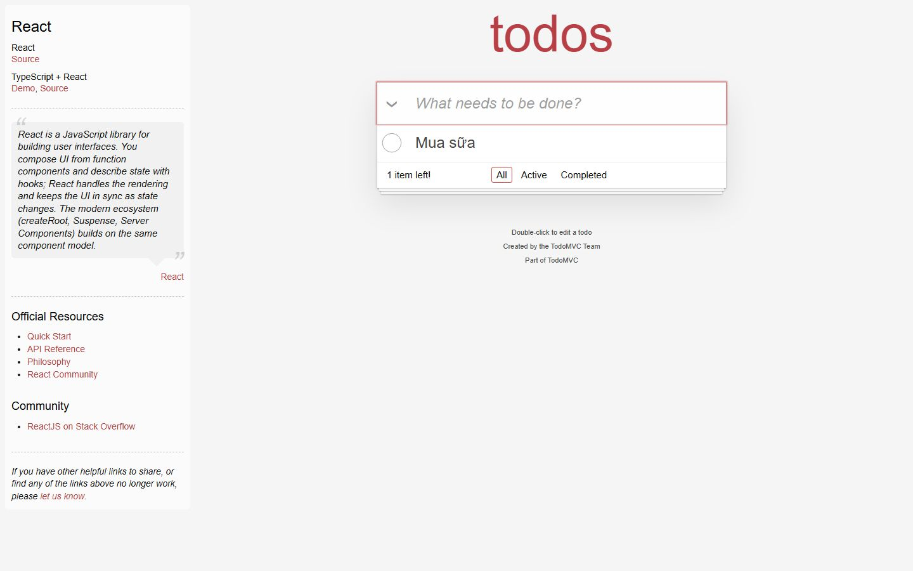
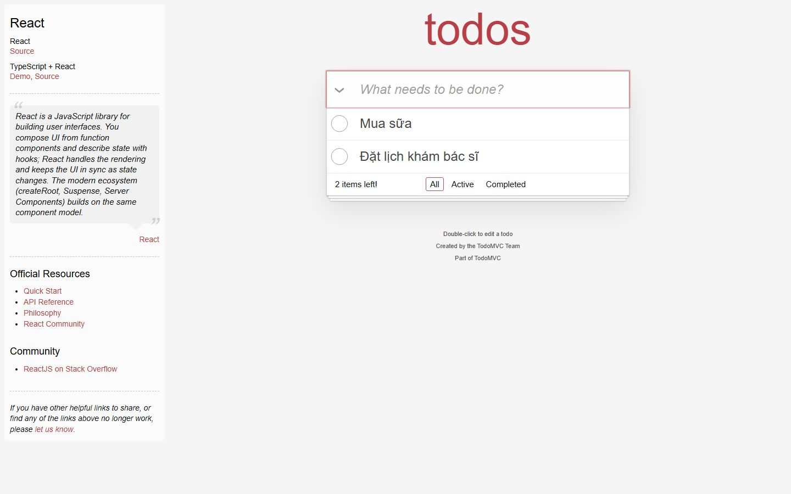
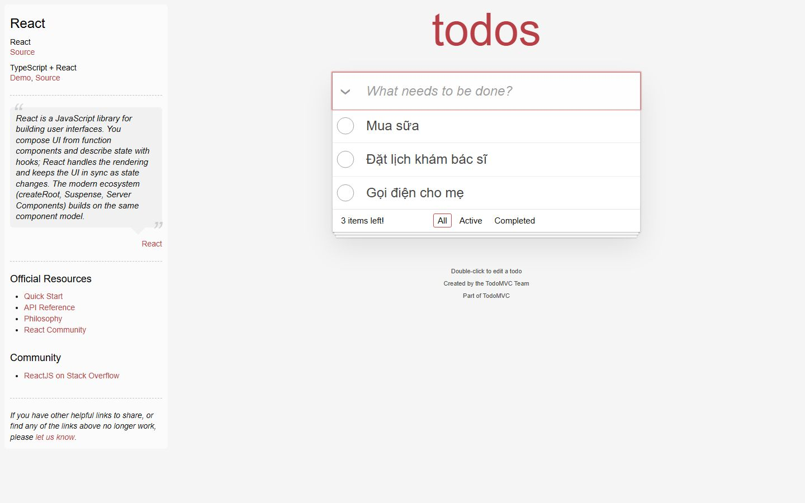
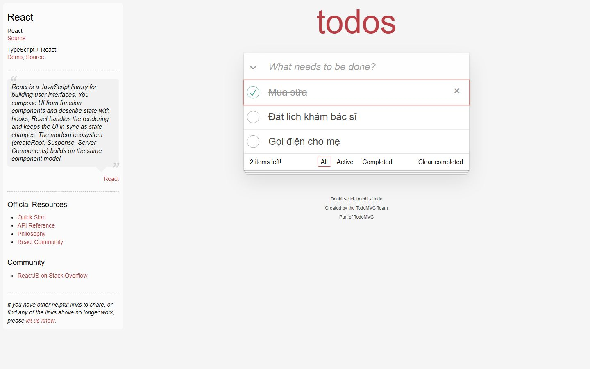
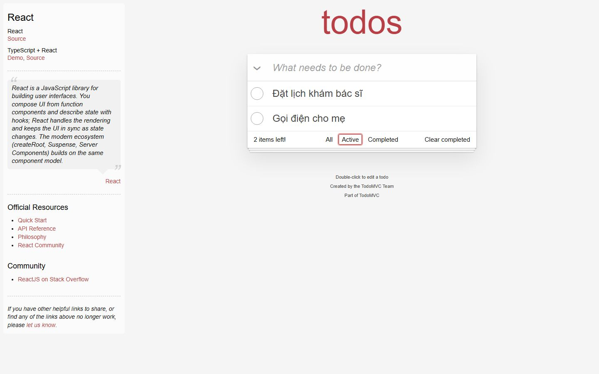
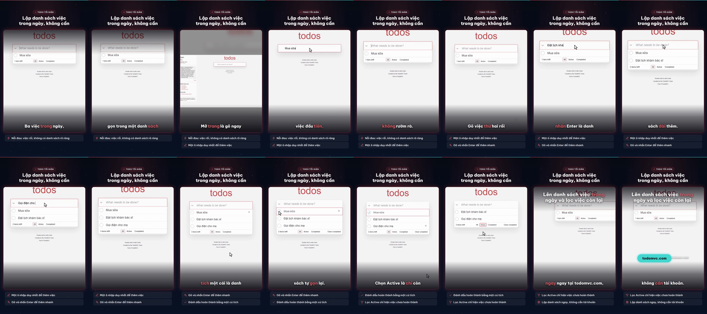

# Nghiệm thu luồng: todomvc

- Trạng thái luồng: **reached_goal** · chính sách gửi: `stop`
- Agent: 6 lần gọi LLM, 39.4 s, model `deepseek-chat`, chỉ đọc chữ, 13836 token; ref bịa bị từ chối: 0; cảnh báo lặp: 0
- Phát lại khi quay: 5/5 bước
- **Request ghi dữ liệu: 0** (agent 0, quay 0) ✔
- Video: 36467 ms, tỉ lệ cảnh quay 0.85
- Nguồn clip: `live` · cắt chờ LLM 5676 ms · cắt 0 đoạn thử lại, 0 đoạn bị từ chối
- Gọi agent: 6 chữ, 0 ảnh (lý do thêm ảnh: None)
- Xung đồng bộ lọt vào video cuối: **False** (phải là False) · still khung đầu: `todomvc-first-frame.png`

## Bảng chương

| Chương | Bước | Thời lượng | Quay | Lời đọc |
|---|---|---|---|---|
| Thêm việc thứ nhất | 1–2 | 6.7 s | recording | Mở trang là gõ ngay việc đầu tiên, một ô nhập duy nhất, không rườm rà. |
| Thêm việc cần làm | 3–4 | 10.3 s | recording | Gõ việc thứ hai rồi việc thứ ba, nhấn Enter là danh sách dài thêm. |
| Đánh dấu hoàn thành | 5–5 | 5.0 s | recording | Việc nào xong, tích một cái là danh sách tự gọn lại. |
| Lọc việc còn lại | 6–6 | 3.9 s | recording | Chọn Active là chỉ còn hai việc chưa xong. |

## Storyboard

### Thêm việc thứ nhất

1. Mở trang bắt đầu  
   
2. Gõ việc cần làm đầu tiên vào ô nhập.  
   

### Thêm việc cần làm

3. Gõ việc thứ hai vào ô nhập để thêm vào danh sách  
   
4. Gõ việc thứ ba 'Gọi điện cho mẹ' vào ô nhập và sẽ nhấn Enter để thêm vào danh sách.  
   

### Đánh dấu hoàn thành

5. Đánh dấu việc Mua sữa đã hoàn thành.  
   

### Lọc việc còn lại

6. Nhấp bộ lọc Active để chỉ hiển thị các việc chưa hoàn thành.  
   

## Lần gọi LLM của cả job

| Bước | Lần gọi | Token vào | Token ra |
|---|---|---|---|
| script | 3 | 18752 | 3849 |
| flow_agent | 6 | 13308 | 528 |
| scene | 5 | 10664 | 1049 |
| fit | 5 | 7789 | 1305 |
| copy_critic | 3 | 4908 | 3529 |
| flow_discovery | 2 | 2958 | 1939 |
| synthesize | 1 | 2608 | 1429 |
| delta | 2 | 2719 | 1016 |
| analyze | 2 | 1845 | 288 |
| classify | 1 | 376 | 92 |

## Contact sheet (16 frame)



## Số liệu

```json
{
  "status": "reached_goal",
  "steps": 6,
  "chapters": 4,
  "agent_llm_calls": 6,
  "agent_seconds": 39.4,
  "agent_model": "deepseek-chat",
  "agent_used_images": false,
  "agent_tokens": 13836,
  "invented_refs": 0,
  "repeat_warnings": 0,
  "replayed": 5,
  "replay_failed_at": null,
  "skipped_steps": [],
  "write_requests": 0,
  "video_ms": 36467,
  "footage_ratio": 0.85,
  "shared_demo_site": false,
  "clip_source": "live",
  "llm_wait_cut_ms": 5676,
  "retry_segments_cut": 0,
  "rejected_segments_cut": 0,
  "text_calls": 6,
  "vision_calls": 0,
  "escalated_because": null,
  "pulse_in_final_video": false,
  "first_frame_still": true,
  "writes_ok": true
}
```
