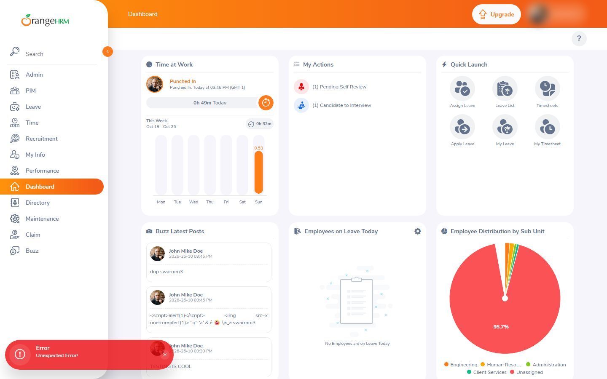
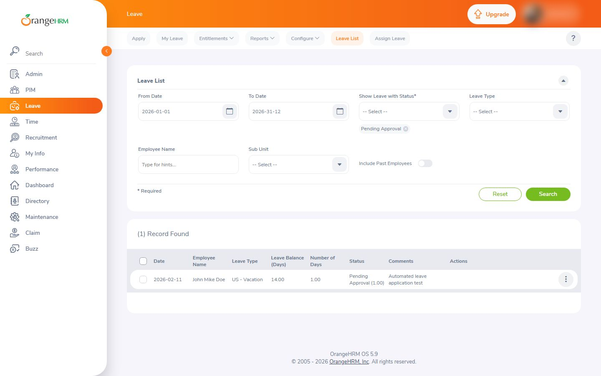
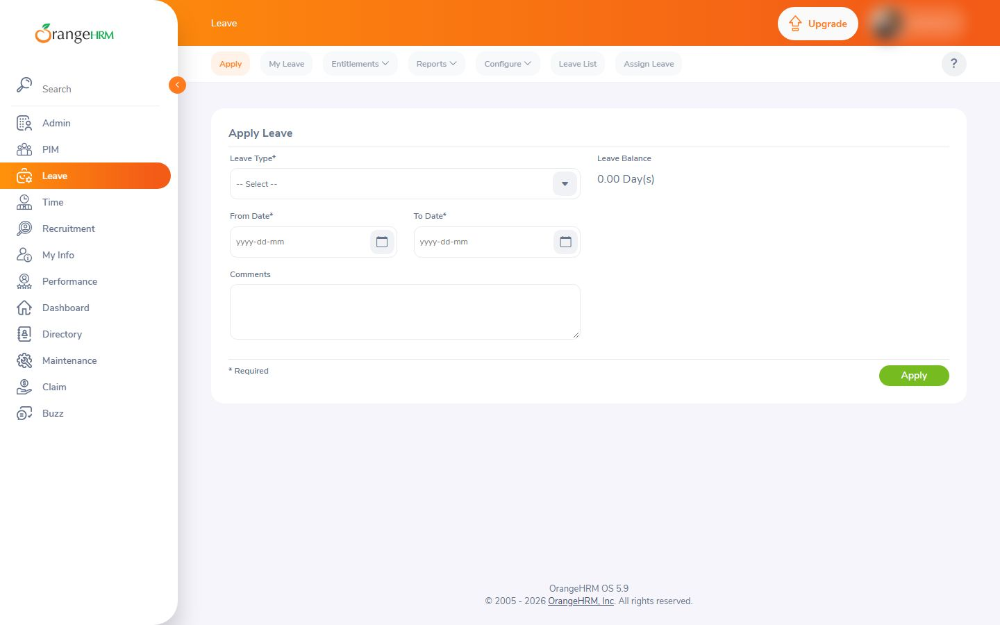
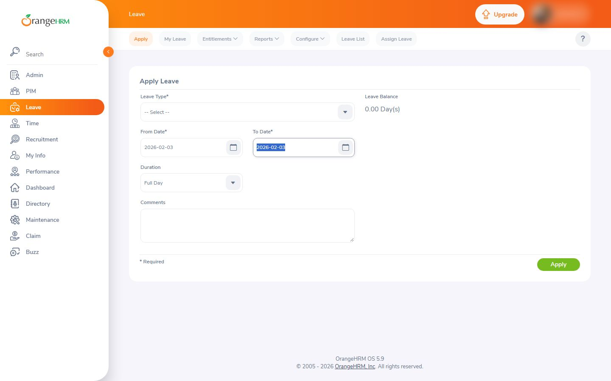
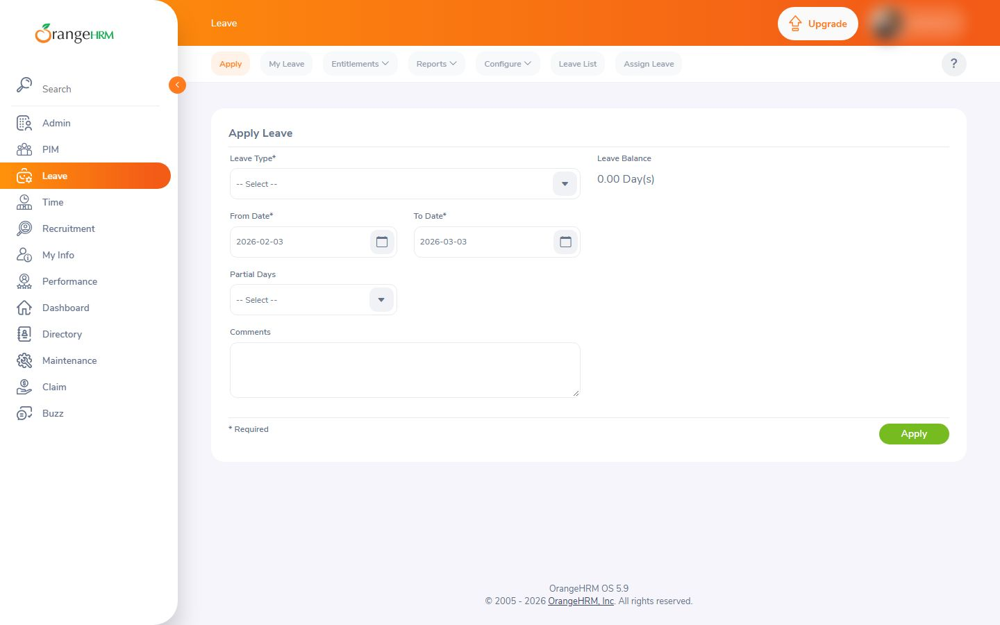
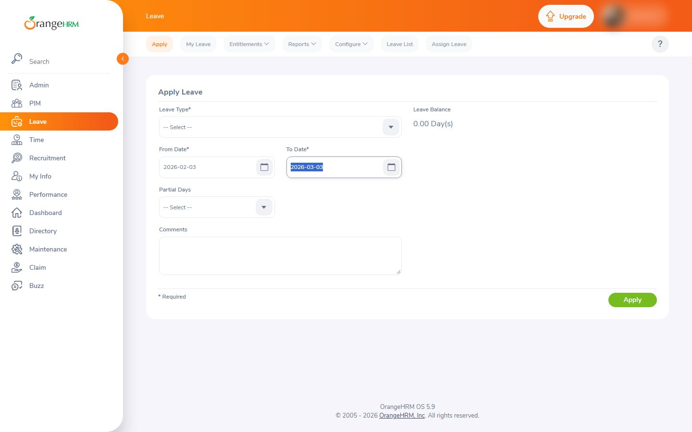
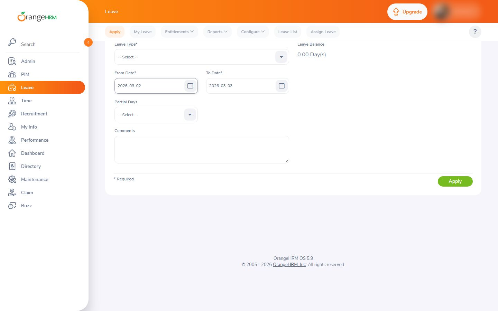

# Nghiệm thu luồng: orangehrm

- Trạng thái luồng: **partial** · chính sách gửi: `stop`
- Agent: 10 lần gọi LLM, 74.8 s, model `deepseek-flash`, có nhìn ảnh, 35093 token; ref bịa bị từ chối: 0; cảnh báo lặp: 2
- Phát lại khi quay: None/10 bước
- **Request ghi dữ liệu: 0** (agent 0, quay 0) ✔
- Video: None ms, tỉ lệ cảnh quay None

## Bảng chương

| Chương | Bước | Thời lượng | Quay | Lời đọc |
|---|---|---|---|---|
| Mở menu Leave | 1–2 | 0.0 s | — | — |
| Mở form | 3–3 | 0.0 s | — | — |
| Điền thông tin | 4–11 | 0.0 s | — | — |

## Storyboard

### Mở menu Leave

1. Mở trang bắt đầu  
   
2. Từ Dashboard, tôi mở menu 'Leave' trên thanh điều hướng bên trái để vào phân hệ nghỉ phép.  
   

### Mở form

3. Mở tab Apply để bắt đầu tạo đơn xin nghỉ phép.  
   

### Điền thông tin

4. Chọn ngày bắt đầu nghỉ phép là 02/03/2026.  
   
5. Cập nhật ngày kết thúc (To Date) thành 03/03/2026 để đơn nghỉ kéo dài đúng 2 ngày.  
   
6. Chỉnh lại ngày bắt đầu nghỉ phép thành 02/03/2026.  
   
7. Cuộn lên để hiển thị đầy đủ trường chọn loại nghỉ phép.  
   
8. Chỉnh lại ngày bắt đầu nghỉ phép thành 02/03/2026.  
   
9. Cuộn lên để hiển thị lại ô chọn Loại nghỉ phép ở đầu biểu mẫu.  
   
10. Sửa lại ngày bắt đầu nghỉ thành 02/03/2026.  
   
11. Cuộn xuống để tìm ô chọn loại nghỉ phép còn thiếu trong danh sách phần tử.  
   

## Cảnh báo

- Dừng: «scroll:» lặp 3 lần mà trang không đổi.

## Lần gọi LLM của cả job

| Bước | Lần gọi | Token vào | Token ra |
|---|---|---|---|
| flow_agent | 21 | 56316 | 13907 |
| synthesize | 1 | 2849 | 4052 |
| flow_discovery | 2 | 3772 | 2072 |
| analyze | 2 | 2100 | 451 |
| classify | 1 | 371 | 98 |

## Số liệu

```json
{
  "status": "partial",
  "steps": 11,
  "chapters": 3,
  "agent_llm_calls": 10,
  "agent_seconds": 74.8,
  "agent_model": "deepseek-flash",
  "agent_used_images": true,
  "agent_tokens": 35093,
  "invented_refs": 0,
  "repeat_warnings": 2,
  "replayed": null,
  "replay_failed_at": null,
  "skipped_steps": [],
  "write_requests": 0,
  "video_ms": null,
  "footage_ratio": null,
  "shared_demo_site": true,
  "writes_ok": true
}
```
