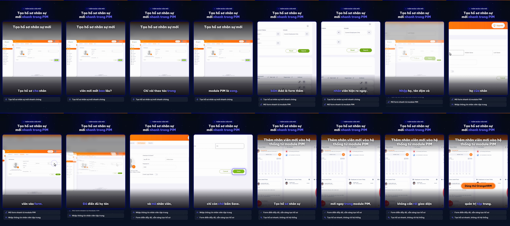

# Nghiệm thu luồng: orangehrm

- Trạng thái luồng: **stopped_before_submit** · chính sách gửi: `stop` · dừng ở nút «Save»
- Agent: 4 lần gọi LLM, 36.1 s, model `deepseek-chat`, chỉ đọc chữ, 9201 token; ref bịa bị từ chối: 0; cảnh báo lặp: 0
- Phát lại khi quay: 5/5 bước
- **Request ghi dữ liệu: 0** (agent 0, quay 0) ✔
- Video: 33333 ms, tỉ lệ cảnh quay 0.764
- Nguồn clip: `live` · cắt chờ LLM 2632 ms · cắt 0 đoạn thử lại, 0 đoạn bị từ chối
- Gọi agent: 4 chữ, 0 ảnh (lý do thêm ảnh: None)
- Xung đồng bộ lọt vào video cuối: **False** (phải là False) · still khung đầu: `orangehrm-first-frame.png`

## Bảng chương

| Chương | Bước | Thời lượng | Quay | Lời đọc |
|---|---|---|---|---|
| Mở form | 1–2 | 5.5 s | recording | Mở module PIM, bấm Add là form thêm nhân viên hiện ra ngay. |
| Điền thông tin | 3–4 | 6.2 s | recording | Nhập họ, tên đệm và họ của nhân viên vào form. |
| Rà soát và dừng | 5–6 | 5.8 s | recording | Đã điền đủ họ tên và mã nhân viên, chỉ còn chờ bấm Save. |

## Storyboard

### Mở form

1. Mở trang bắt đầu  
   
2. Bấm nút Add để mở form thêm nhân viên mới  
   

### Điền thông tin

3. Nhập họ và tên đệm của nhân viên mới vào trường First Name.  
   
4. Nhập họ (Last Name) của nhân viên vào trường Last Name.  
   

### Rà soát và dừng

5. Đã điền đầy đủ họ tên và mã nhân viên, dừng lại ngay trước nút Save.  
   
6. Đã điền đầy đủ họ tên và mã nhân viên, dừng lại ngay trước nút Save.  
   

## Lần gọi LLM của cả job

| Bước | Lần gọi | Token vào | Token ra |
|---|---|---|---|
| flow_discovery | 5 | 10391 | 7979 |
| script | 3 | 14322 | 3022 |
| flow_agent | 7 | 15001 | 589 |
| synthesize | 1 | 3158 | 5205 |
| analyze | 2 | 2243 | 673 |
| fit | 1 | 1335 | 230 |
| classify | 1 | 372 | 103 |

## Contact sheet (16 frame)



## Số liệu

```json
{
  "status": "stopped_before_submit",
  "steps": 6,
  "chapters": 3,
  "agent_llm_calls": 4,
  "agent_seconds": 36.1,
  "agent_model": "deepseek-chat",
  "agent_used_images": false,
  "agent_tokens": 9201,
  "invented_refs": 0,
  "repeat_warnings": 0,
  "replayed": 5,
  "replay_failed_at": null,
  "skipped_steps": [],
  "write_requests": 0,
  "video_ms": 33333,
  "footage_ratio": 0.764,
  "shared_demo_site": true,
  "clip_source": "live",
  "llm_wait_cut_ms": 2632,
  "retry_segments_cut": 0,
  "rejected_segments_cut": 0,
  "text_calls": 4,
  "vision_calls": 0,
  "escalated_because": null,
  "pulse_in_final_video": false,
  "first_frame_still": true,
  "writes_ok": true
}
```
