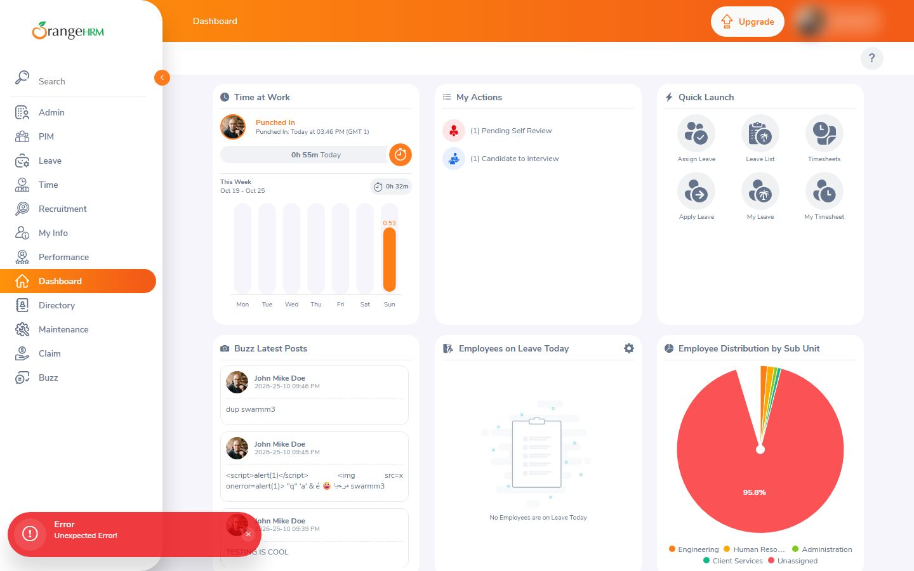
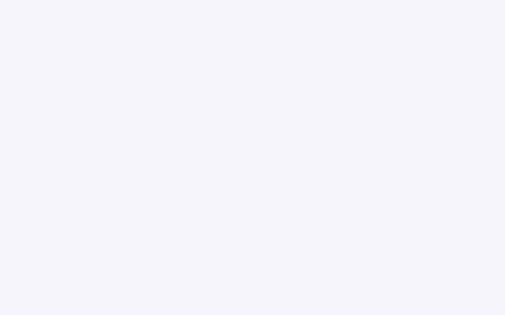
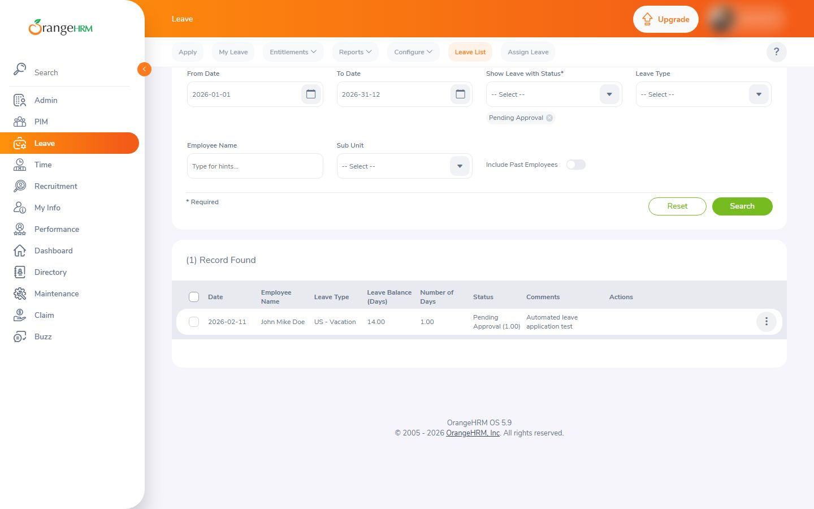
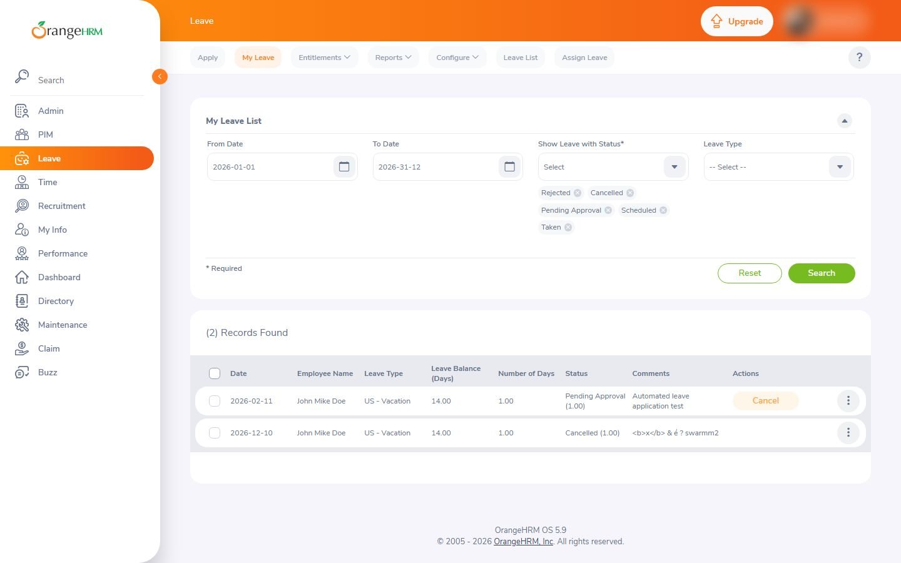
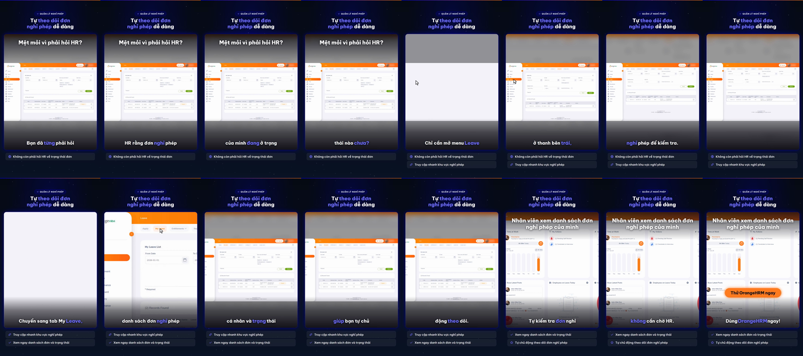

# Nghiệm thu luồng: orangehrm_view

- Trạng thái luồng: **reached_goal** · chính sách gửi: `stop`
- Agent: 4 lần gọi LLM, 25.1 s, model `deepseek-flash`, có nhìn ảnh, 9969 token; ref bịa bị từ chối: 0; cảnh báo lặp: 0
- Phát lại khi quay: 3/3 bước
- **Request ghi dữ liệu: 0** (agent 0, quay 0) ✔
- Video: 32267 ms, tỉ lệ cảnh quay 0.806

## Bảng chương

| Chương | Bước | Thời lượng | Quay | Lời đọc |
|---|---|---|---|---|
| Mở menu Leave | 1–2 | 7.8 s | recording | Chỉ cần mở menu Leave ở thanh bên trái, bạn vào ngay khu vực nghỉ phép để kiểm tra. |
| Mở My Leave | 3–4 | 10.7 s | recording | Chuyển sang tab My Leave, danh sách đơn nghỉ phép cá nhân và trạng thái hiện ra rõ ràng, giúp bạn tự chủ động theo dõi. |

## Storyboard

### Mở menu Leave

1. Mở trang bắt đầu  
   
2. Mở menu Leave ở thanh điều hướng bên trái để vào khu vực nghỉ phép.  
   

### Mở My Leave

3. Trang đang tải, cuộn xuống để xem nội dung danh sách nghỉ phép.  
   
4. Chuyển sang tab My Leave để xem danh sách đơn nghỉ phép cá nhân.  
   

## Lần gọi LLM của cả job

| Bước | Lần gọi | Token vào | Token ra |
|---|---|---|---|
| script | 3 | 12940 | 2457 |
| flow_agent | 4 | 9490 | 479 |
| flow_discovery | 2 | 4180 | 3998 |
| synthesize | 1 | 3024 | 5115 |
| analyze | 2 | 2222 | 630 |
| fit | 2 | 2268 | 467 |
| classify | 1 | 372 | 85 |

## Contact sheet (16 frame)



## Số liệu

```json
{
  "status": "reached_goal",
  "steps": 4,
  "chapters": 2,
  "agent_llm_calls": 4,
  "agent_seconds": 25.1,
  "agent_model": "deepseek-flash",
  "agent_used_images": true,
  "agent_tokens": 9969,
  "invented_refs": 0,
  "repeat_warnings": 0,
  "replayed": 3,
  "replay_failed_at": null,
  "skipped_steps": [],
  "write_requests": 0,
  "video_ms": 32267,
  "footage_ratio": 0.806,
  "shared_demo_site": true,
  "writes_ok": true
}
```
