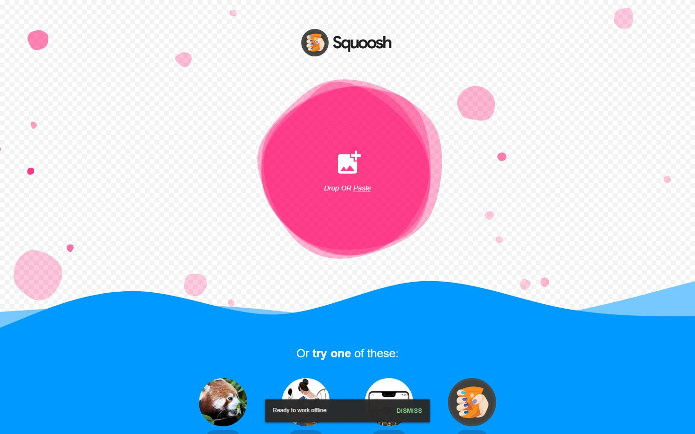
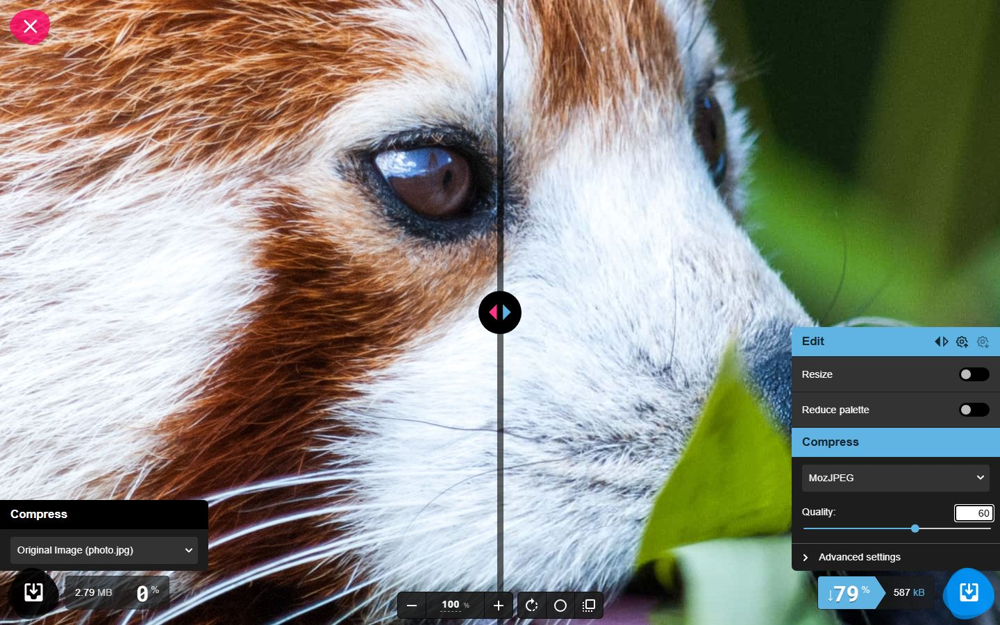
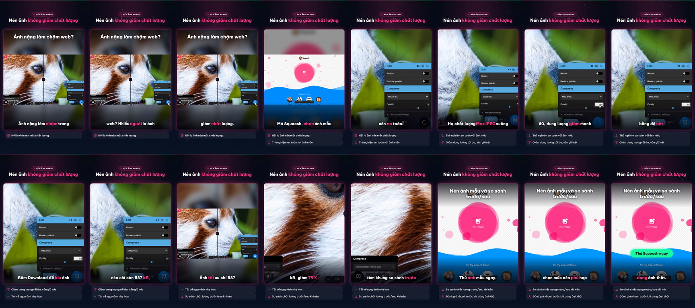

# Nghiệm thu luồng: squoosh

- Trạng thái luồng: **reached_goal** · chính sách gửi: `stop`
- Agent: 7 lần gọi LLM, 57.4 s, model `deepseek-flash`, có nhìn ảnh, 23812 token; ref bịa bị từ chối: 0; cảnh báo lặp: 2
- Phát lại khi quay: 4/4 bước
- **Request ghi dữ liệu: 0** (agent 0, quay 0) ✔
- Video: 37200 ms, tỉ lệ cảnh quay 0.832
- Nguồn clip: `live` · cắt chờ LLM 25662 ms · cắt 0 đoạn thử lại, 0 đoạn bị từ chối
- Gọi agent: 0 chữ, 7 ảnh (lý do thêm ảnh: trang có canvas/svg lớn)
- Xung đồng bộ lọt vào video cuối: **False** (phải là False) · still khung đầu: `squoosh-first-frame.png`

## Bảng chương

| Chương | Bước | Thời lượng | Quay | Lời đọc |
|---|---|---|---|---|
| Chọn ảnh mẫu | 1–2 | 4.7 s | recording | Mở Squoosh, chọn ảnh mẫu 2.8MB để thử nén an toàn. |
| Điều chỉnh cài đặt nén | 3–3 | 6.7 s | recording | Hạ chất lượng MozJPEG xuống 60, dung lượng giảm mạnh mà vẫn cân bằng độ nét. |
| Lưu ảnh tối ưu | 4–4 | 5.8 s | recording | Bấm Download để lưu ảnh nén chỉ còn 587 kB, giảm từ 2.79 MB. |
| Lưu ảnh đã tối ưu | 5–5 | 7.0 s | recording | Ảnh tối ưu chỉ 587 kB, giảm 79%, kèm khung so sánh trước và sau rõ rệt. |

## Storyboard

### Chọn ảnh mẫu

1. Mở trang bắt đầu  
   
2. Bấm chọn ảnh mẫu 'Large photo 2.8MB' để nạp vào trình nén.  
   

### Điều chỉnh cài đặt nén

3. Hạ chất lượng nén MozJPEG xuống 60 để giảm dung lượng ảnh tối đa.  
   

### Lưu ảnh tối ưu

4. Bấm nút Download để lưu ảnh đã nén (587 kB, giảm từ 2.79 MB) về máy.  
   

### Lưu ảnh đã tối ưu

5. Bấm nút Download để lưu ảnh đã nén (587 kB, giảm 79% so với 2.79 MB ban đầu) về máy.  
   

## Cảnh báo

- Bắt đầu gửi kèm ảnh màn hình: trang có canvas/svg lớn.
- stop_before_submit «e15»: ref không phải nút gửi của form
- stop_before_submit «e15»: ref không phải nút gửi của form

## Lần gọi LLM của cả job

| Bước | Lần gọi | Token vào | Token ra |
|---|---|---|---|
| flow_agent | 7 | 19993 | 3819 |
| script | 3 | 15218 | 3747 |
| synthesize | 1 | 2112 | 6590 |
| fit | 4 | 6029 | 1224 |
| flow_discovery | 2 | 3139 | 2426 |
| analyze | 1 | 989 | 351 |
| classify | 1 | 388 | 81 |

## Contact sheet (16 frame)



## Số liệu

```json
{
  "status": "reached_goal",
  "steps": 5,
  "chapters": 4,
  "agent_llm_calls": 7,
  "agent_seconds": 57.4,
  "agent_model": "deepseek-flash",
  "agent_used_images": true,
  "agent_tokens": 23812,
  "invented_refs": 0,
  "repeat_warnings": 2,
  "replayed": 4,
  "replay_failed_at": null,
  "skipped_steps": [],
  "write_requests": 0,
  "video_ms": 37200,
  "footage_ratio": 0.832,
  "shared_demo_site": false,
  "clip_source": "live",
  "llm_wait_cut_ms": 25662,
  "retry_segments_cut": 0,
  "rejected_segments_cut": 0,
  "text_calls": 0,
  "vision_calls": 7,
  "escalated_because": "trang có canvas/svg lớn",
  "pulse_in_final_video": false,
  "first_frame_still": true,
  "writes_ok": true
}
```
