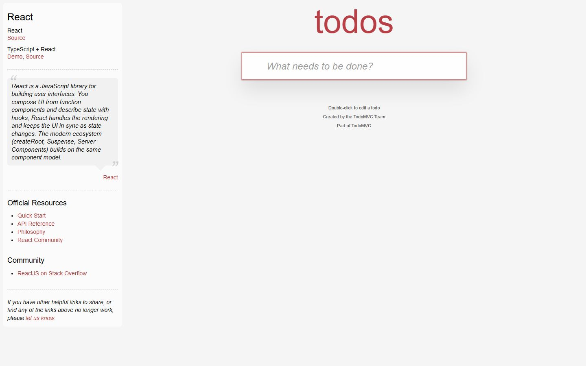
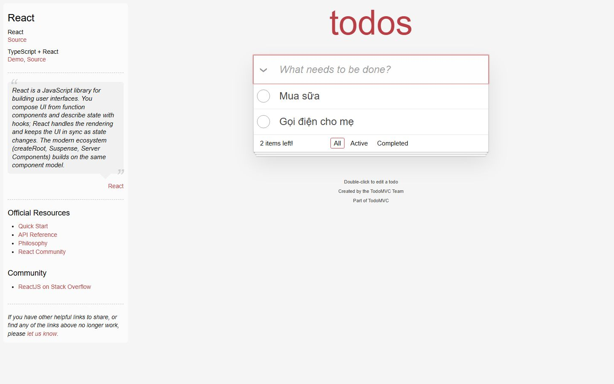
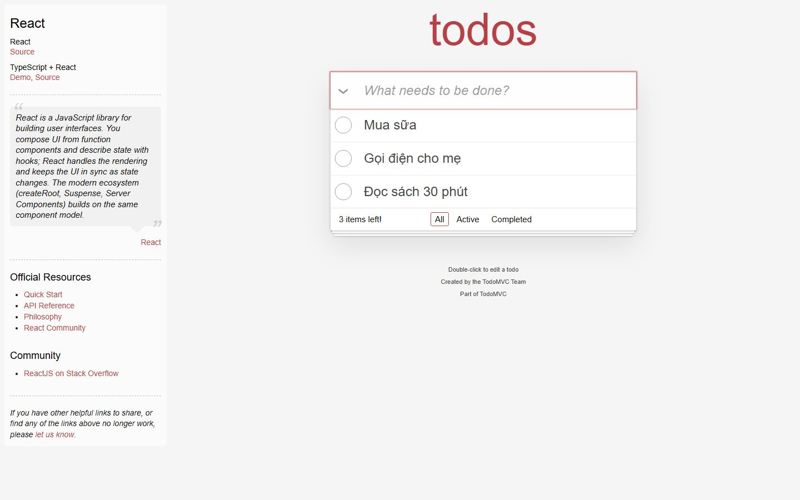
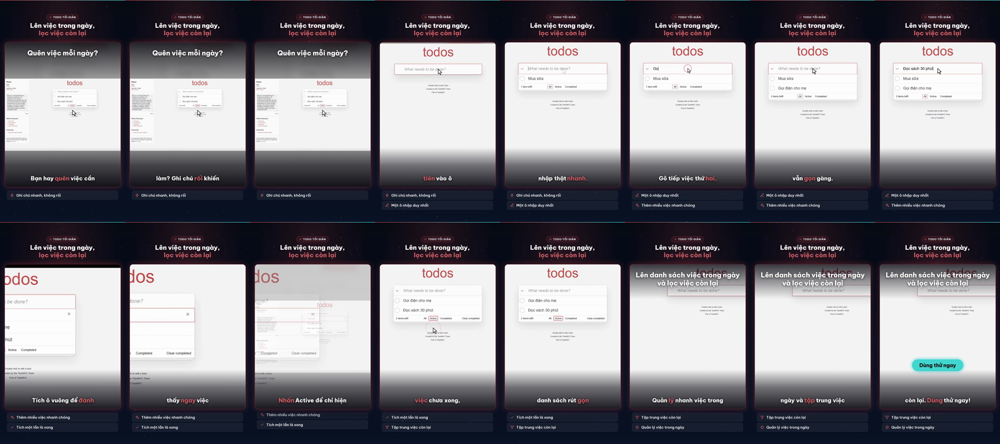

# Nghiệm thu luồng: todomvc

- Trạng thái luồng: **reached_goal** · chính sách gửi: `stop`
- Agent: 6 lần gọi LLM, 36.7 s, model `deepseek-chat`, chỉ đọc chữ, 12912 token; ref bịa bị từ chối: 0; cảnh báo lặp: 0
- Phát lại khi quay: 5/5 bước
- **Request ghi dữ liệu: 0** (agent 0, quay 0) ✔
- Video: 36067 ms, tỉ lệ cảnh quay 0.826
- Nguồn clip: `live` · cắt chờ LLM 4152 ms · cắt 0 đoạn thử lại, 0 đoạn bị từ chối
- Gọi agent: 6 chữ, 0 ảnh (lý do thêm ảnh: None)
- Xung đồng bộ lọt vào video cuối: **False** (phải là False) · still khung đầu: `todomvc-first-frame.png`

## Bảng chương

| Chương | Bước | Thời lượng | Quay | Lời đọc |
|---|---|---|---|---|
| Thêm việc thứ nhất | 1–2 | 4.7 s | recording | Mở trang, gõ việc đầu tiên vào ô nhập thật nhanh. |
| Thêm việc thứ hai | 3–4 | 7.1 s | recording | Gõ tiếp việc thứ hai, thứ ba, danh sách vẫn gọn gàng. |
| Đánh dấu hoàn thành | 5–5 | 5.8 s | recording | Tích ô vuông để đánh dấu hoàn thành, thấy ngay việc nào đã xong. |
| Lọc việc chưa xong | 6–6 | 6.2 s | recording | Nhấn Active để chỉ hiện việc chưa xong, danh sách rút gọn giúp tập trung. |

## Storyboard

### Thêm việc thứ nhất

1. Mở trang bắt đầu  
   
2. Gõ việc đầu tiên vào ô nhập What needs to be done?  
   

### Thêm việc thứ hai

3. Gõ việc thứ hai vào ô nhập để chuẩn bị tạo mục todo mới.  
   
4. Gõ việc thứ ba 'Đọc sách 30 phút' vào ô nhập rồi nhấn Enter để thêm vào danh sách.  
   

### Đánh dấu hoàn thành

5. Tích ô vuông của việc 'Mua sữa' để đánh dấu đã hoàn thành.  
   

### Lọc việc chưa xong

6. Nhấn liên kết Active để chỉ hiển thị các việc chưa hoàn thành.  
   

## Lần gọi LLM của cả job

| Bước | Lần gọi | Token vào | Token ra |
|---|---|---|---|
| script | 3 | 14788 | 3448 |
| flow_agent | 6 | 12391 | 521 |
| fit | 4 | 5803 | 1122 |
| flow_discovery | 2 | 3068 | 2187 |
| delta | 2 | 2687 | 1867 |
| synthesize | 1 | 2625 | 1628 |
| analyze | 2 | 1845 | 284 |
| classify | 1 | 376 | 101 |

## Contact sheet (16 frame)



## Số liệu

```json
{
  "status": "reached_goal",
  "steps": 6,
  "chapters": 4,
  "agent_llm_calls": 6,
  "agent_seconds": 36.7,
  "agent_model": "deepseek-chat",
  "agent_used_images": false,
  "agent_tokens": 12912,
  "invented_refs": 0,
  "repeat_warnings": 0,
  "replayed": 5,
  "replay_failed_at": null,
  "skipped_steps": [],
  "write_requests": 0,
  "video_ms": 36067,
  "footage_ratio": 0.826,
  "shared_demo_site": false,
  "clip_source": "live",
  "llm_wait_cut_ms": 4152,
  "retry_segments_cut": 0,
  "rejected_segments_cut": 0,
  "text_calls": 6,
  "vision_calls": 0,
  "escalated_because": null,
  "pulse_in_final_video": false,
  "first_frame_still": true,
  "writes_ok": true
}
```
