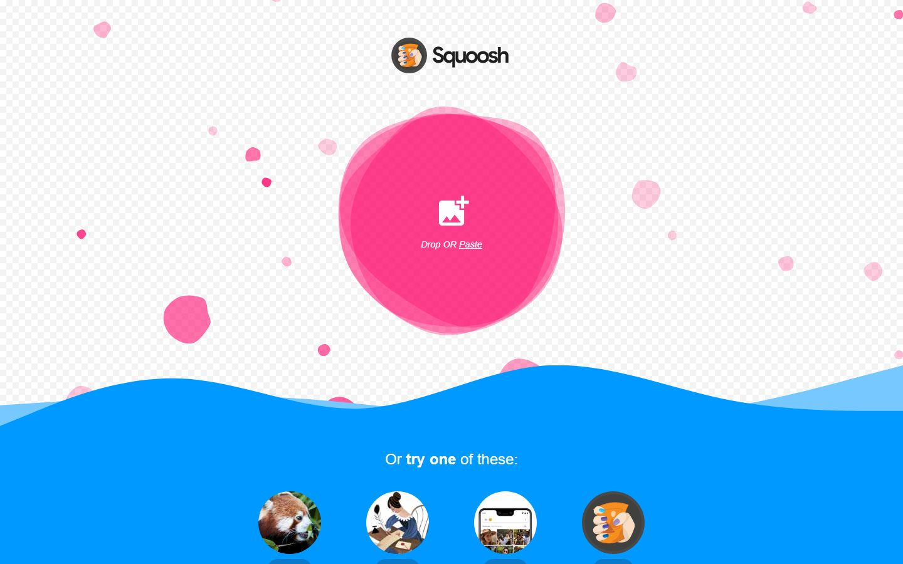
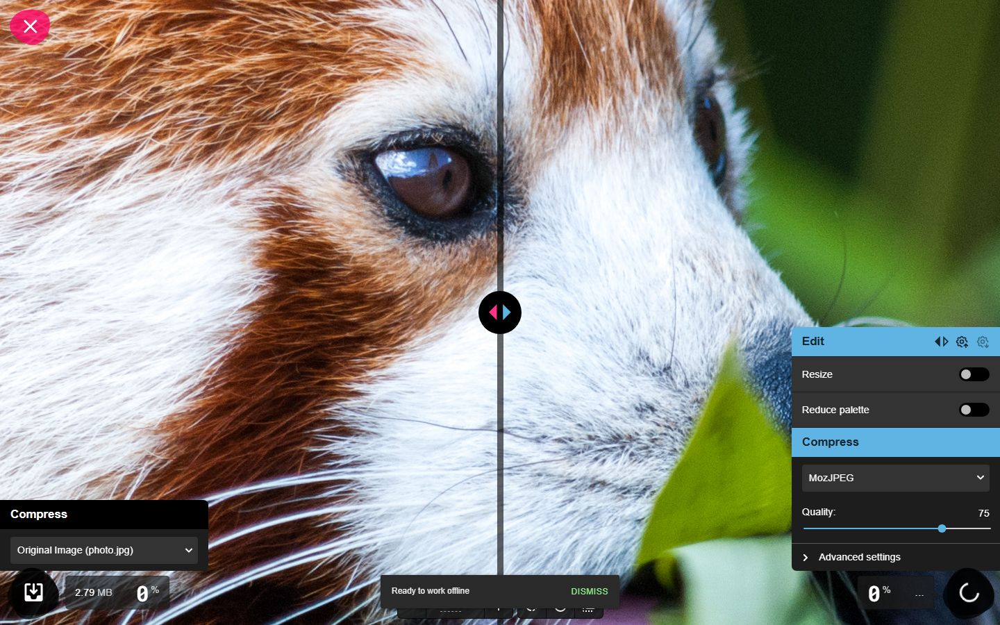
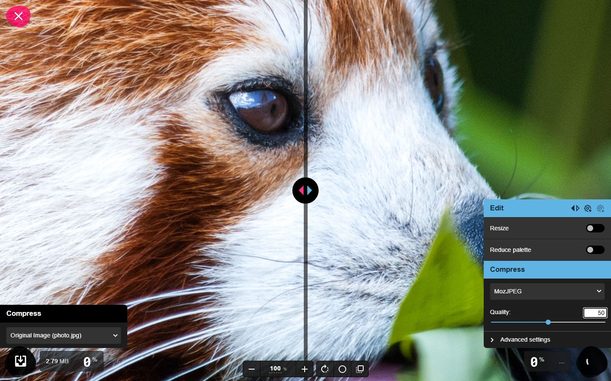
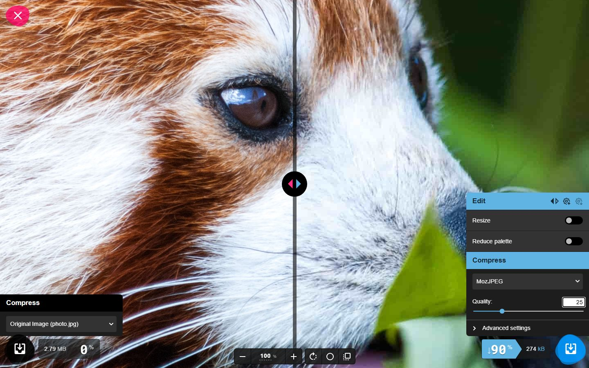
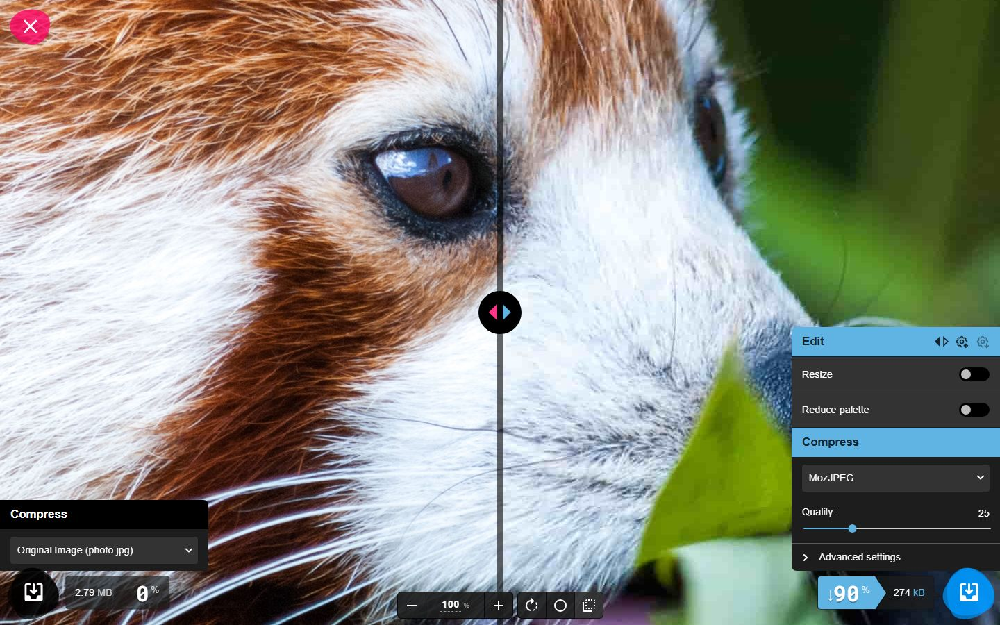
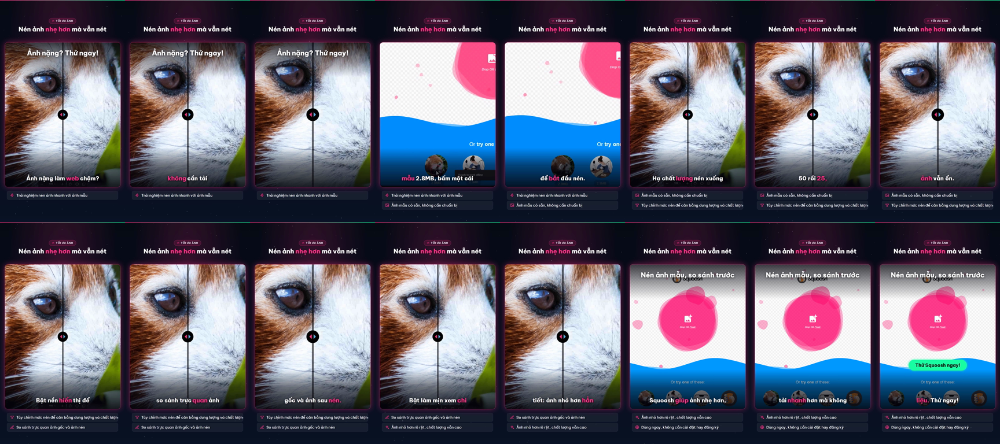

# Nghiệm thu luồng: squoosh

- Trạng thái luồng: **reached_goal** · chính sách gửi: `stop`
- Agent: 6 lần gọi LLM, 27.9 s, model `deepseek-flash`, có nhìn ảnh, 17623 token; ref bịa bị từ chối: 0; cảnh báo lặp: 0
- Phát lại khi quay: 1/5 bước, dừng ở bước 3
- **Request ghi dữ liệu: 0** (agent 0, quay 0) ✔
- Video: 36800 ms, tỉ lệ cảnh quay 0.159

## Bảng chương

| Chương | Bước | Thời lượng | Quay | Lời đọc |
|---|---|---|---|---|
| Chọn ảnh mẫu | 1–2 | 5.8 s | recording | Mở trang là thấy ảnh mẫu 2.8MB, bấm một cái để bắt đầu nén. |
| Điều chỉnh thiết lập nén | 3–4 | 6.7 s | fallback_screenshot | Hạ chất lượng nén xuống 50 rồi 25, dung lượng giảm rõ mà ảnh vẫn ổn. |
| So sánh trước – sau | 5–5 | 6.2 s | fallback_screenshot | Bật nền hiển thị để so sánh trực quan ảnh gốc và ảnh sau nén. |
| Đánh giá chất lượng | 6–6 | 5.5 s | fallback_screenshot | Bật làm mịn xem chi tiết: ảnh nhỏ hơn hẳn mà vẫn nét. |

## Storyboard

### Chọn ảnh mẫu

1. Mở trang bắt đầu  
   
2. Bấm vào ảnh mẫu 'Large photo' (2.8MB) để mở trong công cụ nén.  
   

### Điều chỉnh thiết lập nén

3. Hạ chất lượng nén MozJPEG xuống 50 để thấy dung lượng ảnh giảm rõ rệt.  
   
4. Hạ chất lượng MozJPEG xuống 25 để giảm dung lượng ảnh sau nén nhiều hơn.  
   

### So sánh trước – sau

5. Bật nền hiển thị để dễ đánh giá vùng trong suốt và chất lượng ảnh sau nén.  
   

### Đánh giá chất lượng

6. Bật chế độ làm mịn để dễ quan sát chi tiết ảnh sau nén so với ảnh gốc.  
   

## Cảnh báo

- action[3] type: element not found (css_nth: only 1 matches; bbox: fingerprint at that point does not match; (retried); css_nth: only 1 matches; bbox: fingerprint at that point does not match)
- hook: dùng ảnh storyboard của khoảnh khắc chính
- chương c2 không quay được (bước 3): dùng ảnh storyboard
- chương c3 không quay được (bước 3): dùng ảnh storyboard
- chương c4 không quay được (bước 3): dùng ảnh storyboard

## Lần gọi LLM của cả job

| Bước | Lần gọi | Token vào | Token ra |
|---|---|---|---|
| script | 3 | 15722 | 3699 |
| flow_agent | 6 | 15596 | 2027 |
| fit | 4 | 6135 | 1184 |
| flow_discovery | 2 | 4031 | 3079 |
| delta | 2 | 3134 | 2405 |
| synthesize | 1 | 2082 | 2513 |
| analyze | 1 | 978 | 387 |
| classify | 1 | 388 | 110 |

## Contact sheet (16 frame)



## Số liệu

```json
{
  "status": "reached_goal",
  "steps": 6,
  "chapters": 4,
  "agent_llm_calls": 6,
  "agent_seconds": 27.9,
  "agent_model": "deepseek-flash",
  "agent_used_images": true,
  "agent_tokens": 17623,
  "invented_refs": 0,
  "repeat_warnings": 0,
  "replayed": 1,
  "replay_failed_at": 3,
  "skipped_steps": [],
  "write_requests": 0,
  "video_ms": 36800,
  "footage_ratio": 0.159,
  "shared_demo_site": false,
  "writes_ok": true
}
```
