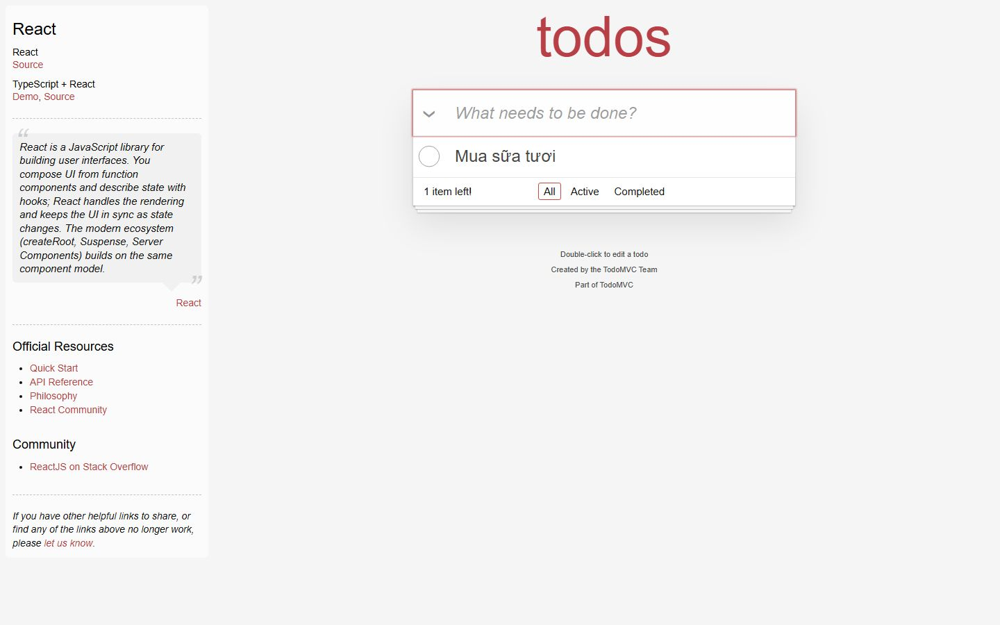
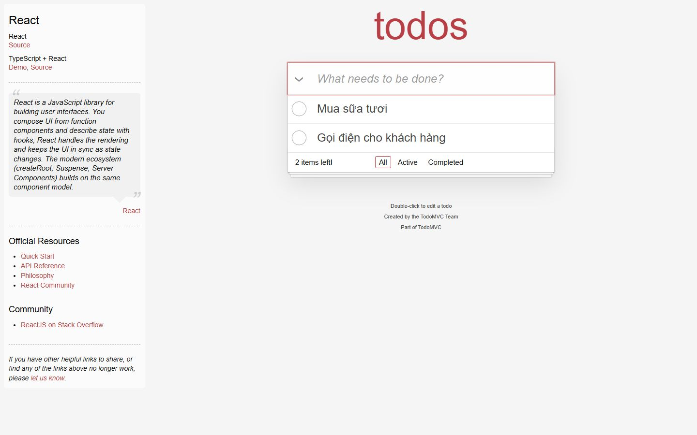
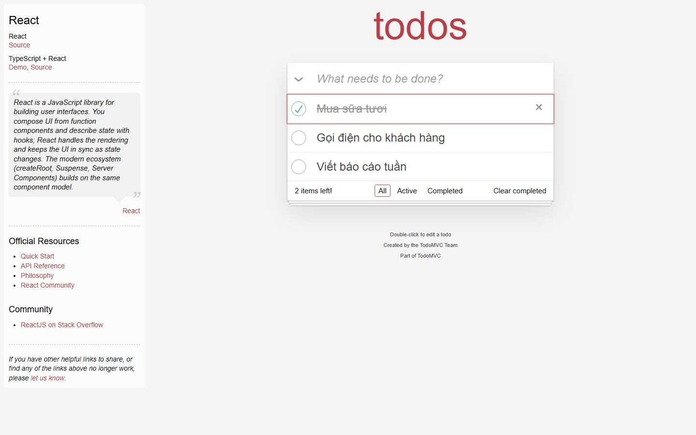
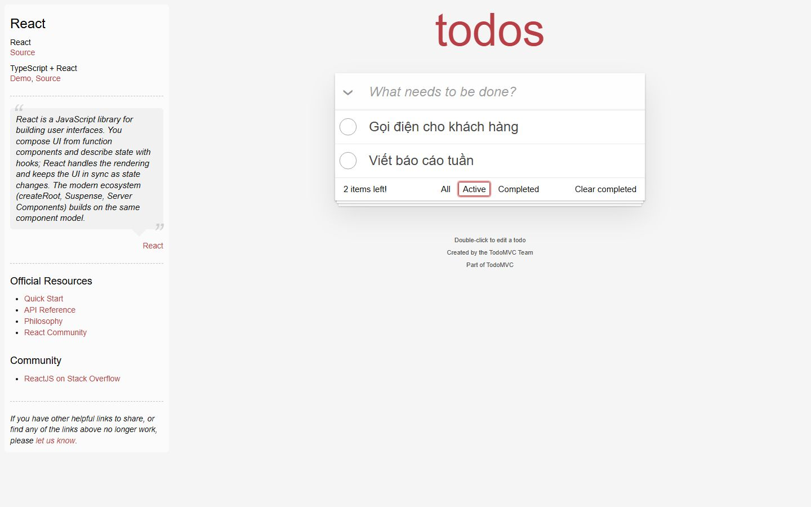
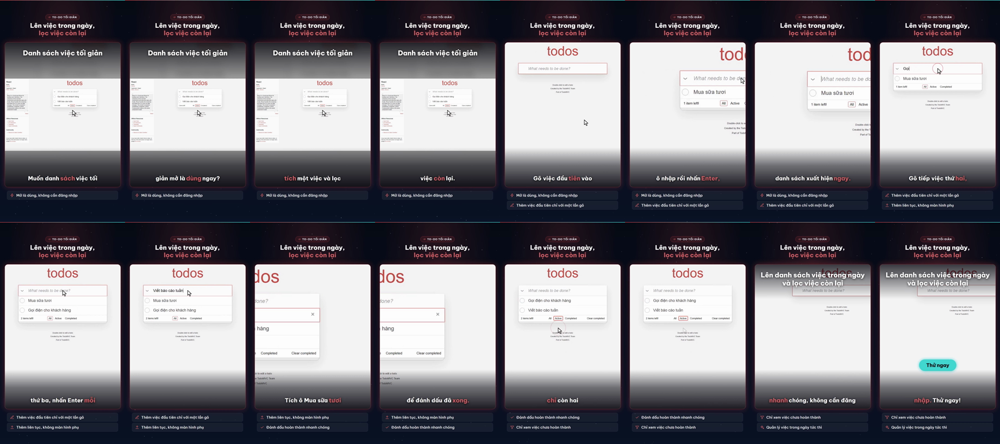

# Nghiệm thu luồng: todomvc

- Trạng thái luồng: **reached_goal** · chính sách gửi: `stop`
- Agent: 6 lần gọi LLM, 19.6 s, model `deepseek-flash`, có nhìn ảnh, 15879 token; ref bịa bị từ chối: 0; cảnh báo lặp: 0
- Phát lại khi quay: 5/5 bước
- **Request ghi dữ liệu: 0** (agent 0, quay 0) ✔
- Video: 35700 ms, tỉ lệ cảnh quay 0.847

## Bảng chương

| Chương | Bước | Thời lượng | Quay | Lời đọc |
|---|---|---|---|---|
| Thêm việc đầu tiên | 1–2 | 6.2 s | recording | Gõ việc đầu tiên vào ô nhập rồi nhấn Enter, danh sách xuất hiện ngay. |
| Thêm việc thứ hai | 3–4 | 6.8 s | recording | Gõ tiếp việc thứ hai, thứ ba, nhấn Enter mỗi lần để thêm liên tục. |
| Đánh dấu hoàn thành | 5–5 | 4.2 s | recording | Tích ô Mua sữa tươi để đánh dấu đã xong. |
| Lọc việc còn lại | 6–6 | 4.2 s | recording | Nhấn bộ lọc Active, chỉ còn hai việc chưa xong. |

## Storyboard

### Thêm việc đầu tiên

1. Mở trang bắt đầu  
   
2. Gõ việc đầu tiên vào ô nhập và nhấn Enter để thêm vào danh sách.  
   

### Thêm việc thứ hai

3. Gõ việc thứ hai vào ô nhập và nhấn Enter để thêm vào danh sách.  
   
4. Gõ việc thứ ba 'Viết báo cáo tuần' vào ô nhập.  
   

### Đánh dấu hoàn thành

5. Tích vào ô đánh dấu của việc 'Mua sữa tươi' để đánh dấu đã xong.  
   

### Lọc việc còn lại

6. Nhấn bộ lọc Active để chỉ hiển thị các việc chưa hoàn thành.  
   

## Lần gọi LLM của cả job

| Bước | Lần gọi | Token vào | Token ra |
|---|---|---|---|
| script | 3 | 15500 | 4313 |
| flow_agent | 6 | 14847 | 1032 |
| fit | 4 | 6105 | 1247 |
| synthesize | 1 | 2591 | 2224 |
| flow_discovery | 2 | 2986 | 1675 |
| delta | 2 | 2701 | 1194 |
| analyze | 2 | 1845 | 253 |
| classify | 1 | 376 | 74 |

## Contact sheet (16 frame)



## Số liệu

```json
{
  "status": "reached_goal",
  "steps": 6,
  "chapters": 4,
  "agent_llm_calls": 6,
  "agent_seconds": 19.6,
  "agent_model": "deepseek-flash",
  "agent_used_images": true,
  "agent_tokens": 15879,
  "invented_refs": 0,
  "repeat_warnings": 0,
  "replayed": 5,
  "replay_failed_at": null,
  "skipped_steps": [],
  "write_requests": 0,
  "video_ms": 35700,
  "footage_ratio": 0.847,
  "shared_demo_site": false,
  "writes_ok": true
}
```
