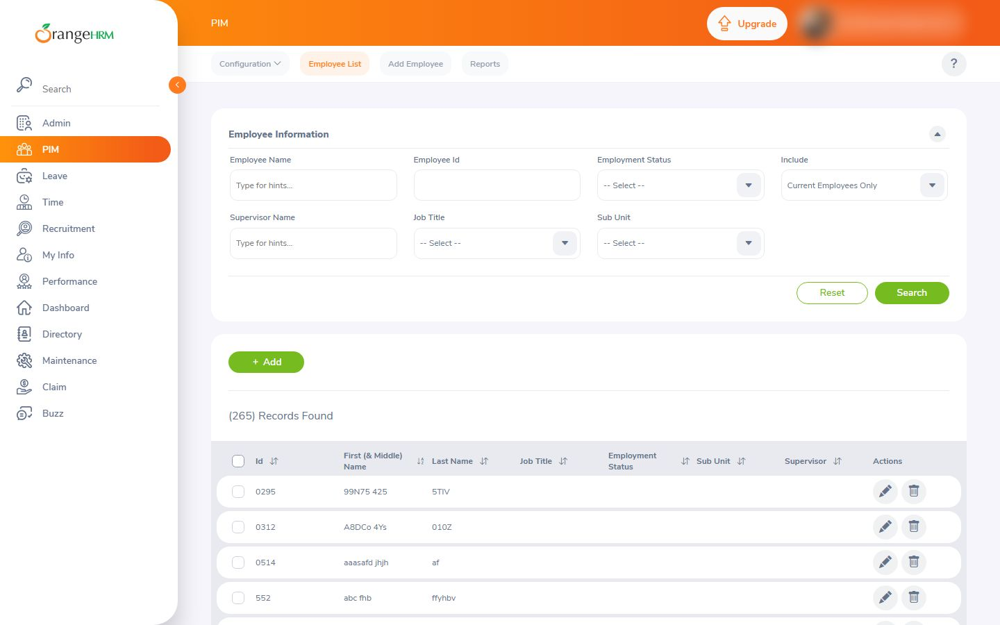
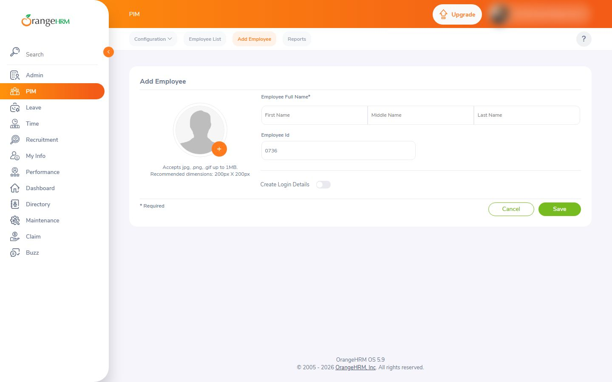
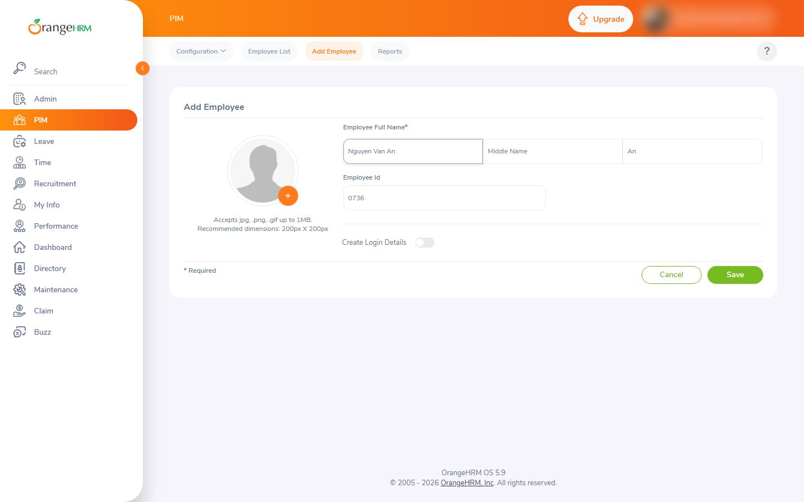
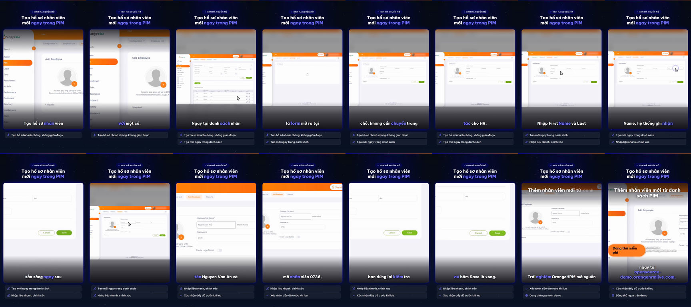

# Nghiệm thu luồng: orangehrm_add

- Trạng thái luồng: **stopped_before_submit** · chính sách gửi: `stop` · dừng ở nút «Save»
- Agent: 6 lần gọi LLM, 54.2 s, model `deepseek-chat + deepseek-flash`, có nhìn ảnh, 15139 token; ref bịa bị từ chối: 0; cảnh báo lặp: 1
- Phát lại khi quay: 7/7 bước
- **Request ghi dữ liệu: 0** (agent 0, quay 0) ✔
- Video: 43500 ms, tỉ lệ cảnh quay 0.893
- Nguồn clip: `live` · cắt chờ LLM 7115 ms · cắt 0 đoạn thử lại, 0 đoạn bị từ chối
- Gọi agent: 5 chữ, 1 ảnh (lý do thêm ảnh: cảnh báo lặp)
- Xung đồng bộ lọt vào video cuối: **False** (phải là False) · still khung đầu: `orangehrm_add-first-frame.png`

## Bảng chương

| Chương | Bước | Thời lượng | Quay | Lời đọc |
|---|---|---|---|---|
| Mở form | 1–2 | 11.1 s | recording | Ngay tại danh sách nhân viên PIM, bấm nút Add là form mở ra tại chỗ, không cần chuyển trang — tiết kiệm thao tác cho HR. |
| Điền thông tin | 3–6 | 10.8 s | recording | Nhập First Name và Last Name, hệ thống ghi nhận tự động, hồ sơ đã sẵn sàng ngay sau khi điền xong. |
| Kiểm tra trước khi lưu | 7–8 | 11.8 s | recording | Form đã có đủ họ tên Nguyen Van An và mã nhân viên 0736, bạn dừng lại kiểm tra một lượt, rồi chỉ một cú bấm Save là xong. |

## Storyboard

### Mở form

1. Mở trang bắt đầu  
   
2. Bấm nút Add để mở form thêm nhân viên mới  
   

### Điền thông tin

3. Nhập họ tên nhân viên vào trường First Name  
   
4. Nhập họ (Last Name) vào trường còn trống để hoàn tất họ tên nhân viên.  
   
5. Nhập họ tên đầy đủ vào trường First Name gợi ý.  
   
6. Nhập họ và tên đệm vào trường First Name.  
   

### Kiểm tra trước khi lưu

7. Form Add Employee đã có đủ họ tên (Nguyen Van An / An) và mã nhân viên 0736, dừng lại để kiểm tra trước khi bấm Save.  
   
8. Form Add Employee đã có đủ họ tên (Nguyen Van An / An) và mã nhân viên 0736, dừng lại để kiểm tra trước khi bấm Save.  
   

## Cảnh báo

- Bắt đầu gửi kèm ảnh màn hình: cảnh báo lặp.

## Lần gọi LLM của cả job

| Bước | Lần gọi | Token vào | Token ra |
|---|---|---|---|
| script | 3 | 20125 | 2951 |
| flow_agent | 6 | 14310 | 829 |
| scene | 5 | 13587 | 944 |
| copy_critic | 3 | 6394 | 3516 |
| flow_discovery | 2 | 4539 | 3895 |
| synthesize | 1 | 3201 | 4336 |
| delta | 2 | 2740 | 1496 |
| fit | 2 | 2928 | 613 |
| analyze | 2 | 2277 | 603 |
| classify | 1 | 372 | 90 |

## Contact sheet (16 frame)



## Số liệu

```json
{
  "status": "stopped_before_submit",
  "steps": 8,
  "chapters": 3,
  "agent_llm_calls": 6,
  "agent_seconds": 54.2,
  "agent_model": "deepseek-chat + deepseek-flash",
  "agent_used_images": true,
  "agent_tokens": 15139,
  "invented_refs": 0,
  "repeat_warnings": 1,
  "replayed": 7,
  "replay_failed_at": null,
  "skipped_steps": [],
  "write_requests": 0,
  "video_ms": 43500,
  "footage_ratio": 0.893,
  "shared_demo_site": true,
  "clip_source": "live",
  "llm_wait_cut_ms": 7115,
  "retry_segments_cut": 0,
  "rejected_segments_cut": 0,
  "text_calls": 5,
  "vision_calls": 1,
  "escalated_because": "cảnh báo lặp",
  "pulse_in_final_video": false,
  "first_frame_still": true,
  "writes_ok": true
}
```
