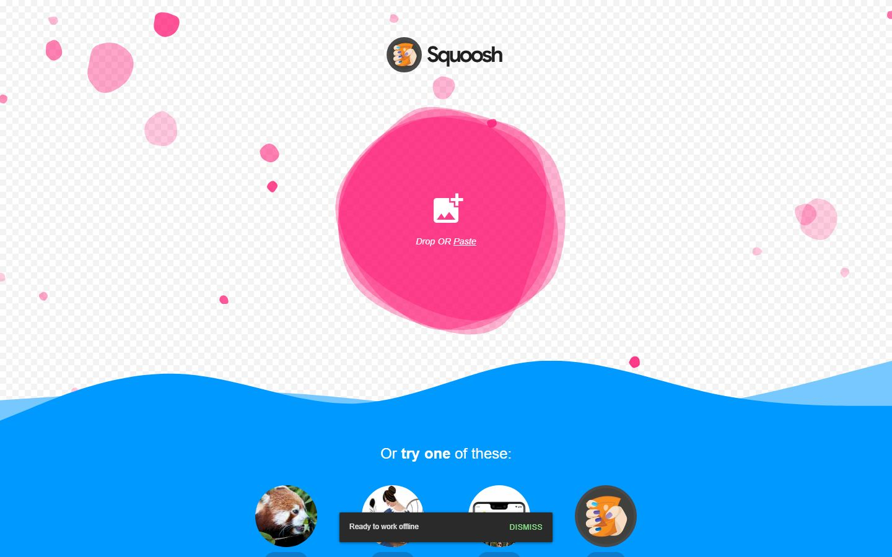
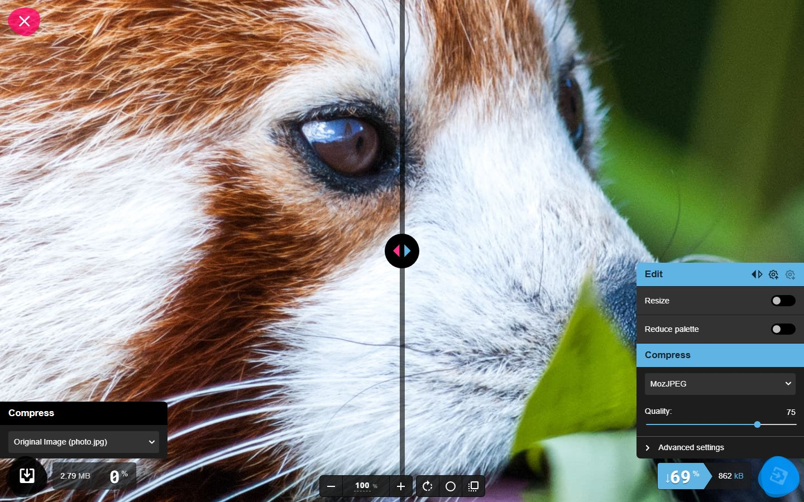
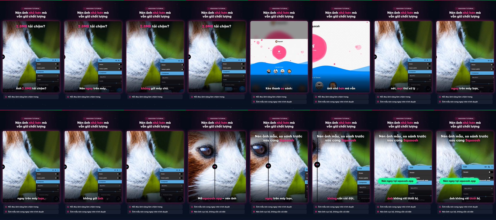

# Nghiệm thu luồng: squoosh

- Trạng thái luồng: **reached_goal** · chính sách gửi: `stop`
- Agent: 2 lần gọi LLM, 18.8 s, model `deepseek-flash`, có nhìn ảnh, 6196 token; ref bịa bị từ chối: 0; cảnh báo lặp: 0
- Phát lại khi quay: 1/1 bước
- **Request ghi dữ liệu: 0** (agent 0, quay 0) ✔
- Video: 22400 ms, tỉ lệ cảnh quay 0.667
- Nguồn clip: `live` · cắt chờ LLM 5172 ms · cắt 0 đoạn thử lại, 0 đoạn bị từ chối
- Gọi agent: 0 chữ, 2 ảnh (lý do thêm ảnh: trang có canvas/svg lớn)
- Xung đồng bộ lọt vào video cuối: **False** (phải là False) · still khung đầu: `squoosh-first-frame.png`

## Bảng chương

| Chương | Bước | Thời lượng | Quay | Lời đọc |
|---|---|---|---|---|
| Chọn ảnh mẫu | 1–2 | 9.8 s | recording | Kéo thanh so sánh: ảnh nhỏ hơn mà vẫn nét, mọi thứ xử lý ngay trên máy bạn, không gửi ảnh lên máy chủ. |

## Storyboard

### Chọn ảnh mẫu

1. Mở trang bắt đầu  
   
2. Mở Squoosh và chọn ảnh mẫu Large photo (2.8MB) để bắt đầu tối ưu.  
   

## Cảnh báo

- Bắt đầu gửi kèm ảnh màn hình: trang có canvas/svg lớn.

## Lần gọi LLM của cả job

| Bước | Lần gọi | Token vào | Token ra |
|---|---|---|---|
| script | 3 | 16169 | 2534 |
| synthesize | 2 | 6774 | 10178 |
| scene | 4 | 8841 | 814 |
| copy_critic | 3 | 4503 | 3162 |
| flow_agent | 2 | 5521 | 675 |
| flow_discovery | 2 | 3325 | 2396 |
| fit | 4 | 4340 | 919 |
| analyze | 1 | 989 | 334 |
| classify | 1 | 388 | 72 |

## Contact sheet (16 frame)



## Số liệu

```json
{
  "status": "reached_goal",
  "steps": 2,
  "chapters": 1,
  "agent_llm_calls": 2,
  "agent_seconds": 18.8,
  "agent_model": "deepseek-flash",
  "agent_used_images": true,
  "agent_tokens": 6196,
  "invented_refs": 0,
  "repeat_warnings": 0,
  "replayed": 1,
  "replay_failed_at": null,
  "skipped_steps": [],
  "write_requests": 0,
  "video_ms": 22400,
  "footage_ratio": 0.667,
  "shared_demo_site": false,
  "clip_source": "live",
  "llm_wait_cut_ms": 5172,
  "retry_segments_cut": 0,
  "rejected_segments_cut": 0,
  "text_calls": 0,
  "vision_calls": 2,
  "escalated_because": "trang có canvas/svg lớn",
  "pulse_in_final_video": false,
  "first_frame_still": true,
  "writes_ok": true
}
```
