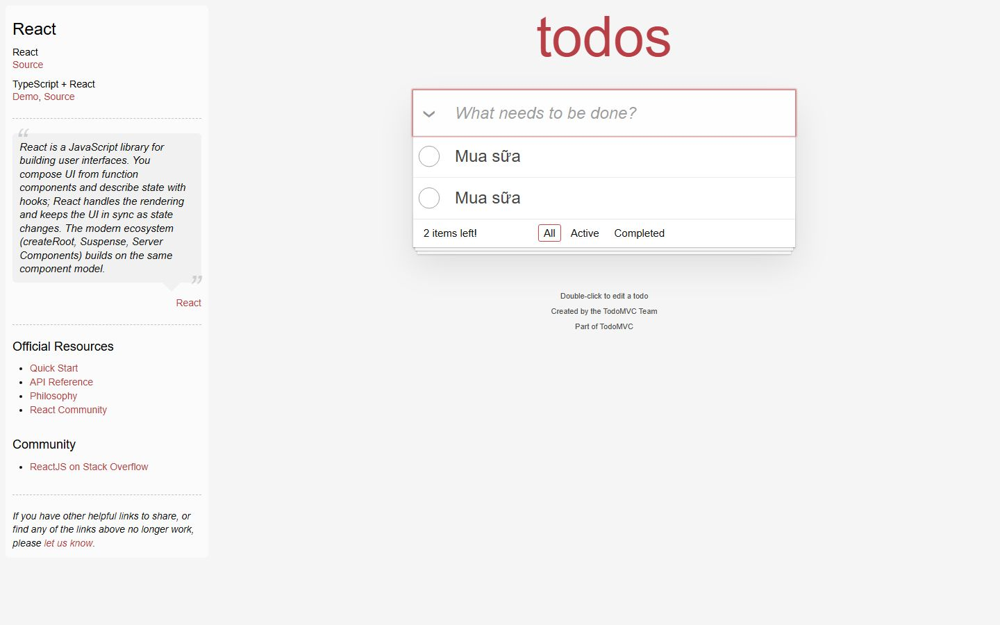
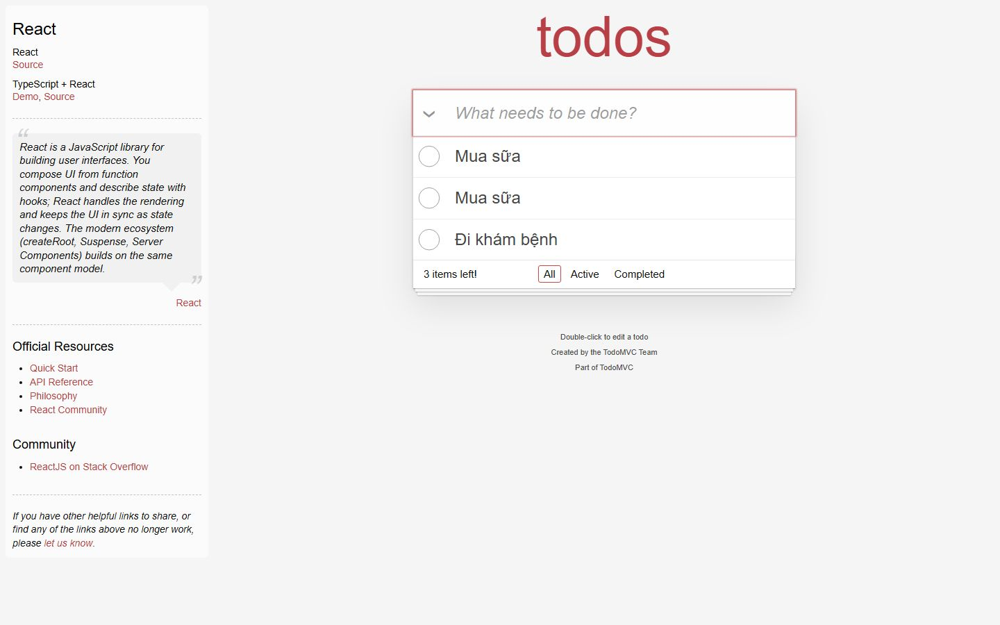
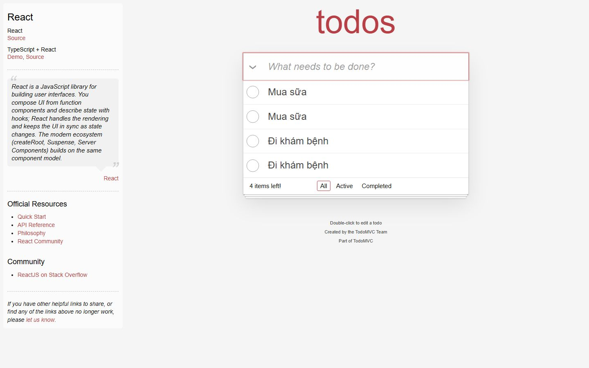
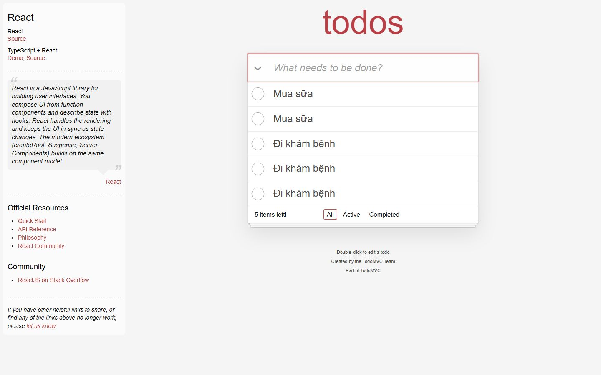
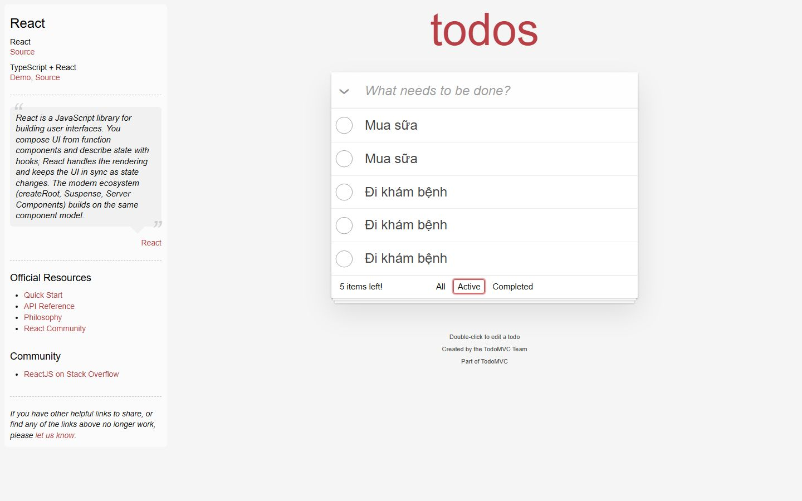
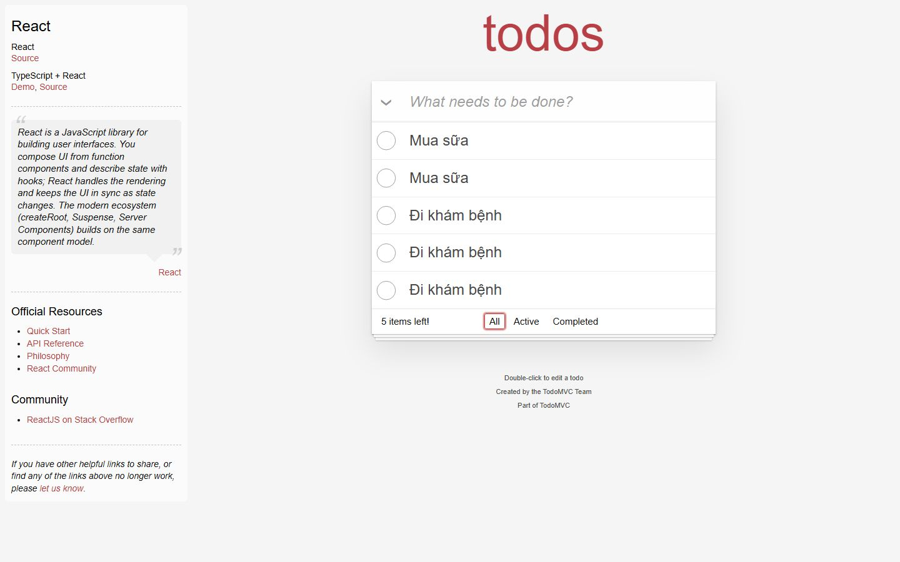
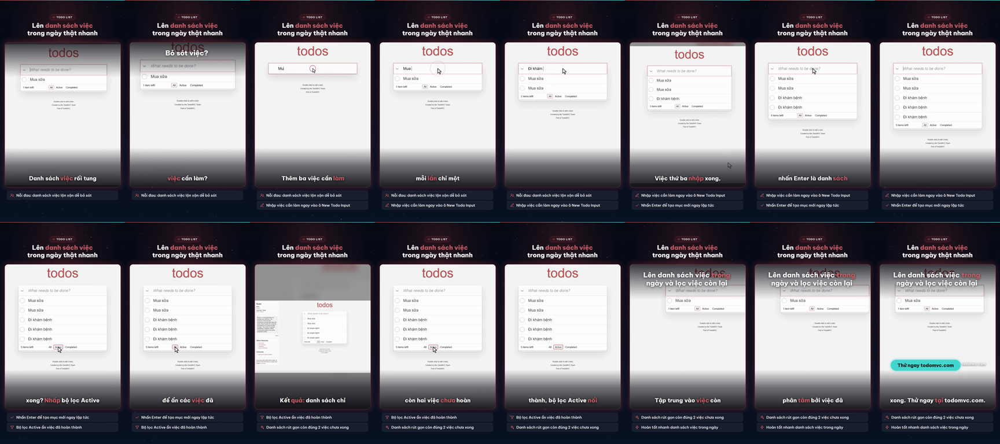

# Nghiệm thu luồng: todomvc

- Trạng thái luồng: **reached_goal** · chính sách gửi: `stop`
- Agent: 9 lần gọi LLM, 55.7 s, model `deepseek-chat`, chỉ đọc chữ, 21667 token; ref bịa bị từ chối: 0; cảnh báo lặp: 0
- Phát lại khi quay: 8/8 bước
- **Request ghi dữ liệu: 0** (agent 0, quay 0) ✔
- Video: 43867 ms, tỉ lệ cảnh quay 0.812
- Nguồn clip: `live` · cắt chờ LLM 8016 ms · cắt 0 đoạn thử lại, 0 đoạn bị từ chối
- Gọi agent: 9 chữ, 0 ảnh (lý do thêm ảnh: None)
- Xung đồng bộ lọt vào video cuối: **False** (phải là False) · still khung đầu: `todomvc-first-frame.png`

## Bảng chương

| Chương | Bước | Thời lượng | Quay | Lời đọc |
|---|---|---|---|---|
| Thêm việc cần làm | 1–4 | 8.5 s | recording | Thêm ba việc cần làm trong ngày vào ô nhập, mỗi lần chỉ một dòng ngắn gọn. |
| Thêm việc thứ ba | 5–6 | 7.0 s | recording | Việc thứ ba nhập xong, nhấn Enter là danh sách đủ ba mục, gọn trong một dòng. |
| Lọc việc còn lại | 7–8 | 7.5 s | recording | Chỉ muốn xem việc chưa xong? Nhấp bộ lọc Active để ẩn các việc đã hoàn thành đi. |
| Lọc việc còn lại | 9–9 | 7.5 s | recording | Kết quả: danh sách chỉ còn hai việc chưa hoàn thành, bộ lọc Active nổi bật rõ ràng. |

## Storyboard

### Thêm việc cần làm

1. Mở trang bắt đầu  
   
2. Nhập việc thứ nhất vào ô New Todo Input.  
   
3. Đã thêm việc 'Mua sữa', tiếp tục nhập việc thứ hai.  
   
4. Nhập việc thứ ba vào ô New Todo Input và nhấn Enter để tạo mục mới.  
   

### Thêm việc thứ ba

5. Nhập việc thứ ba vào ô nhập và sẽ nhấn Enter để tạo mục todo.  
   
6. Nhập việc thứ ba 'Đi khám bệnh' vào ô New Todo Input và nhấn Enter để hoàn tất 3 việc.  
   

### Lọc việc còn lại

7. Nhấp bộ lọc Active để chỉ hiển thị các việc chưa hoàn thành.  
   
8. Nhấp All để xem toàn bộ danh sách và xác nhận trạng thái các mục trước khi kết thúc.  
   

### Lọc việc còn lại

9. Nhấp bộ lọc Active để chỉ hiển thị các việc chưa hoàn thành.  
   

## Lần gọi LLM của cả job

| Bước | Lần gọi | Token vào | Token ra |
|---|---|---|---|
| script | 3 | 19518 | 3856 |
| flow_agent | 9 | 20749 | 918 |
| scene | 7 | 15819 | 1540 |
| copy_critic | 3 | 5449 | 3407 |
| synthesize | 1 | 2626 | 3847 |
| flow_discovery | 2 | 2866 | 1829 |
| delta | 2 | 2680 | 1235 |
| analyze | 2 | 1845 | 286 |
| classify | 1 | 376 | 130 |

## Contact sheet (16 frame)



## Số liệu

```json
{
  "status": "reached_goal",
  "steps": 9,
  "chapters": 4,
  "agent_llm_calls": 9,
  "agent_seconds": 55.7,
  "agent_model": "deepseek-chat",
  "agent_used_images": false,
  "agent_tokens": 21667,
  "invented_refs": 0,
  "repeat_warnings": 0,
  "replayed": 8,
  "replay_failed_at": null,
  "skipped_steps": [],
  "write_requests": 0,
  "video_ms": 43867,
  "footage_ratio": 0.812,
  "shared_demo_site": false,
  "clip_source": "live",
  "llm_wait_cut_ms": 8016,
  "retry_segments_cut": 0,
  "rejected_segments_cut": 0,
  "text_calls": 9,
  "vision_calls": 0,
  "escalated_because": null,
  "pulse_in_final_video": false,
  "first_frame_still": true,
  "writes_ok": true
}
```
